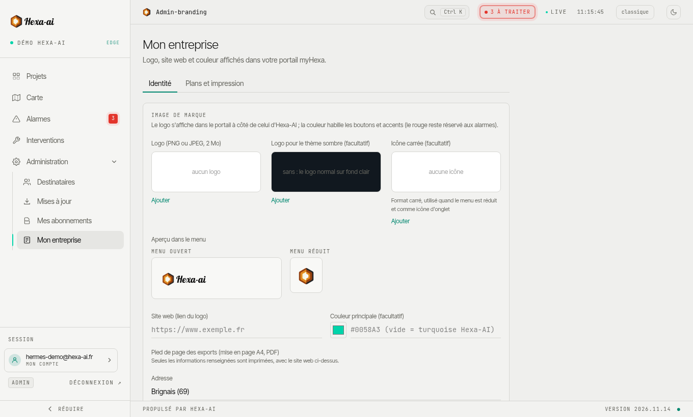
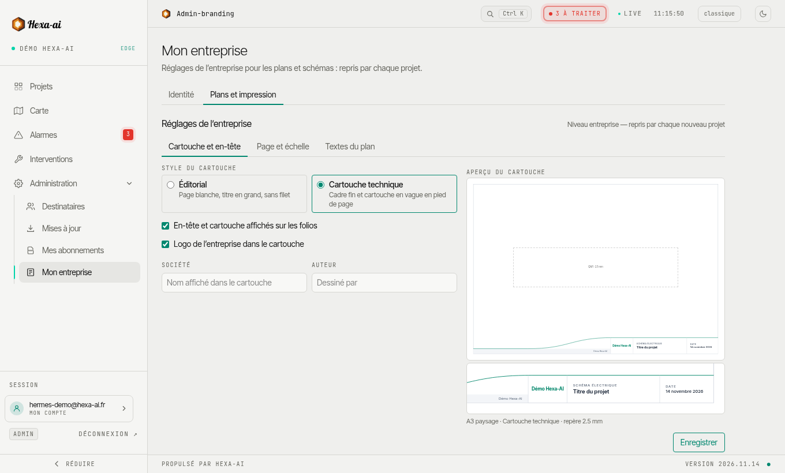

The **Mon entreprise** (My company) page (**Administration** menu, visible to administrators) has two tabs: **Identité** (Identity) and **Plans et impression** (Plans and printing).

## Identity

The **brand image** dresses your portal: the **logo** appears next to Hexa-AI's (PNG or JPEG, 2 MB), with an optional **dark theme** variant and a **square icon** used when the menu is collapsed and as tab icon. The **website** becomes the logo link. The **main colour** tints buttons and accents (bright red stays reserved for alarms and is not applied). A preview shows the menu open and collapsed.

The **export footer** (A4 layout, PDF) prints, besides the website, the address, phone, contact e-mail and up to 3 free lines (company ID, legal notice, tagline…). Only the information you enter is printed.

## Plans and printing

These settings apply to all your diagrams and are inherited by each project:

- **Title block style**: **Éditorial** (white page, large title, no rules) or **Cartouche technique** (thin frame and wave-shaped title block at the foot);
- **header and title block shown on sheets**, **company logo in the title block**, **Société** (company) and **Auteur** (author);
- **page and scale**, and **plan texts**: text sizes in paper millimetres (device marker, labels and wires, terminals and ports), identical in A4 and A3;
- a **title block preview** updates live.

**Enregistrer** applies the settings. The project title, prefix, revision index and date are then set per dossier: see [Layout, printing and export](/en/portal/synoptics/export/).
