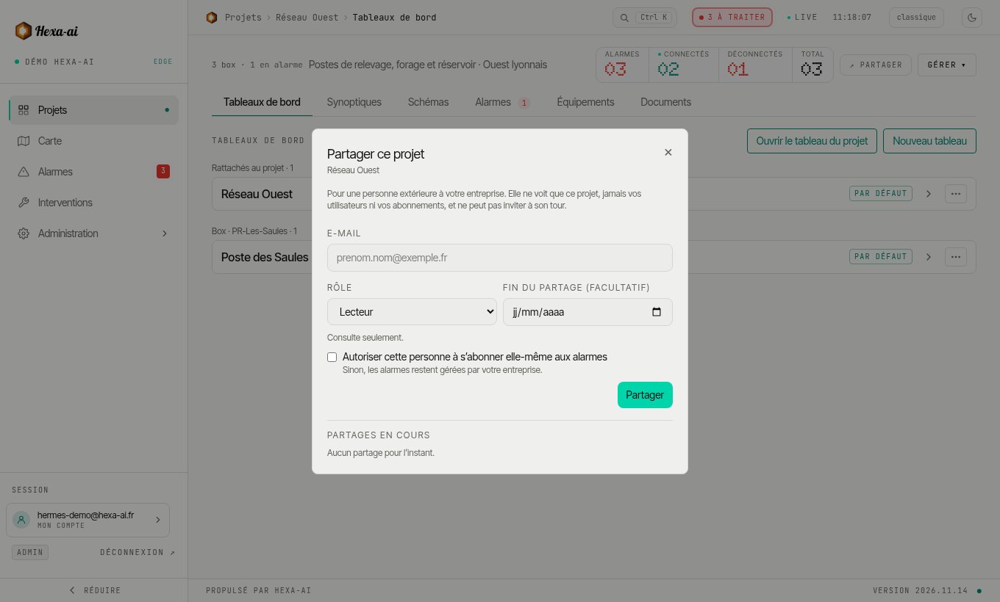

You can show part of your portal to someone outside your company (partner, end client, design office, subcontractor) **without opening the rest**.

## Share

The **↗ Partager** (Share) button is on the page of a **project**, a **box**, a **synoptic** and a **dashboard**.

1. Click **Partager**.
2. Enter the person's **e-mail**.
3. Choose their **role**:
   - for a project: **Lecteur**, **Opérateur** or **Gestionnaire** (see [Roles](/en/portal/administration/roles/));
   - for a box: **Lecteur** or **Opérateur**;
   - for a synoptic: **Lecteur** or **Modification de cet élément** (edit this synoptic, nothing else);
   - for a dashboard: **Lecteur**.
4. Optionally set an end of sharing: access stops by itself on that date.
5. For a project or box, tick **Autoriser cette personne à s'abonner elle-même aux alarmes** (allow this person to subscribe to alarms themselves) if they should receive them (otherwise alarms stay managed by your company).
6. **Partager**.

The **Partages en cours** (Current shares) list shows who has access, with role and end date, and lets you **Retirer** (Remove) access at any time: it is cut immediately.

Sharing is for company administrators. The overview of all your shares is under **Destinataires ▸ Accès portail ▸ Partages**.

## What the invited person sees

- Only the shared item, with the chosen role: never the rest of your company, nor your users or subscriptions.
- A viewer edits nothing and cannot re-share.
- The person finds what was shared under **Partagés avec moi** (Shared with me, a menu entry visible as soon as a share is active), grouped by company.

## See what is shared with you

If another company shared an item with you, the **Partagés avec moi** page lists it; click to open it. If nothing is shared, the page says so ("Rien n'est partagé avec vous pour l'instant").
