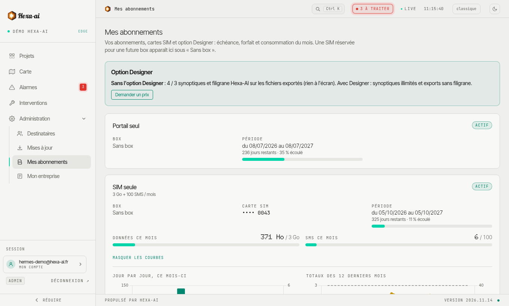

The **Mes abonnements** (My subscriptions) page (**Administration** menu) gathers what is subscribed for your company: the portal subscription, the boxes' SIM cards and the Designer option.

For each subscription:

- the **type** (portal only, SIM only, Designer option…) and its status (**Actif**);
- the **box** concerned (or **Sans box**: a SIM reserved for a future box appears this way);
- the **period** (start and end dates), with days left and a progress bar;
- for a **SIM card**: the plan (e.g. 3 GB · 100 SMS / month), the **data** and **SMS** used this month, and a day-by-day curve (**Masquer les courbes** folds it).

For the **Designer option**, the card shows the synoptic limit and, if the option is not active, offers **Demander un prix** (see [The Designer option](/en/portal/synoptics/designer/)).

Subscriptions cannot be edited here: **to renew or change plan, contact Hexa-AI**. The menu entry appears for administrators, and for other roles as soon as a subscription is visible.
