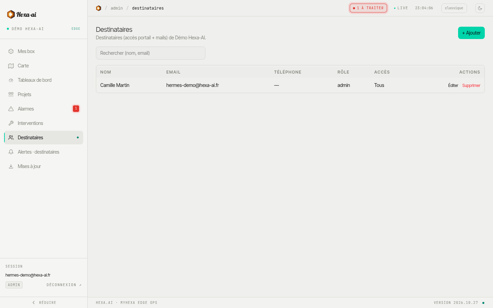

The **Destinataires** (Recipients) page, restricted to administrators, lists the people who have access to the portal for your company, and who receive its emails (invitations, reports).

## Invite a person

1. **+ Ajouter** (Add).
2. Name, email and, if needed, phone number.
3. Choose the **role**:
   - **Viewer** (reader): can view;
   - **Admin**: can also invite, set alarms and start updates.
4. Choose the **box access**:
   - **Tous les équipements** (All devices): including those added later;
   - **Sélection limitée** (Limited selection): only the ticked boxes.
5. **Créer + envoyer l'invitation** (Create + send the invitation): the person receives an email to choose their password.

The email address cannot be changed afterwards; the role and the access can.

## External person

Tick **Destinataire externe** (External recipient) for a person who does not belong to your company (a subcontractor, an end customer): they see **only** the boxes you share with them (at least one must be selected).

To show a single dashboard, without giving access to the boxes, use [dashboard sharing](/en/portal/dashboards/sharing/) instead.
