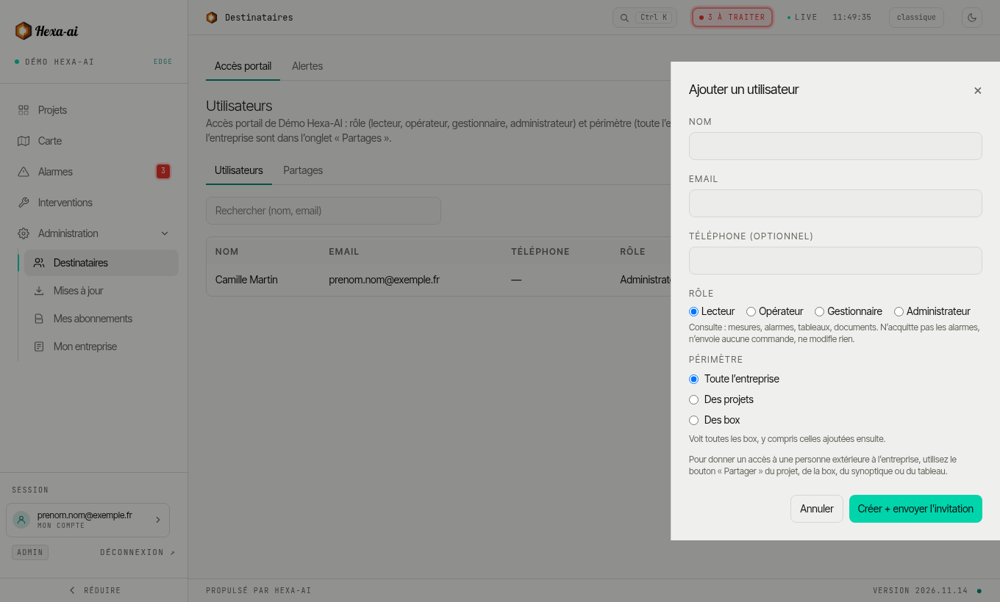

The **Destinataires** (Recipients) page (**Administration** menu), for administrators, manages the people who have access to the portal for your company. It has two tabs: **Accès portail** (Portal access, this page) and **Alertes** (see [Alarm recipients](/en/portal/alarms/alarm-recipients/)).

In **Accès portail**, two sub-tabs: **Utilisateurs** (Users) and **Partages** (Shares: access given to outside people, see [Sharing with an outside person](/en/portal/administration/external-sharing/)). The list shows each person's name, e-mail, phone, **role** and **access** (whole company, N projects or N boxes). The search field filters by name or e-mail.

## Invite a person

1. **+ Ajouter un utilisateur** (Add a user).
2. Enter the **name**, **e-mail** and, if needed, the phone number.
3. Choose the **role**: **Lecteur**, **Opérateur**, **Gestionnaire** or **Administrateur** ([role details](/en/portal/administration/roles/)).
4. Choose the **scope**: **Toute l'entreprise**, **Des projets** (tick the projects) or **Des box** (tick the boxes). An administrator always covers the whole company.
5. **Créer + envoyer l'invitation** (Create + send the invitation): the person receives an e-mail to choose a password.

The e-mail address cannot be changed afterwards; name, phone, role and scope can. **Éditer** (Edit) modifies a person, **Supprimer** (Delete) removes their access.

## Home page

In a person's sheet you can set their **home page at sign-in** (a page or a specific dashboard).

## Outside person

For someone who does not belong to your company, do not create a user: use the **Partager** button of the project, box, synoptic or dashboard concerned. The person is neither invited to your company nor counted among your users, and sees only what you share.
