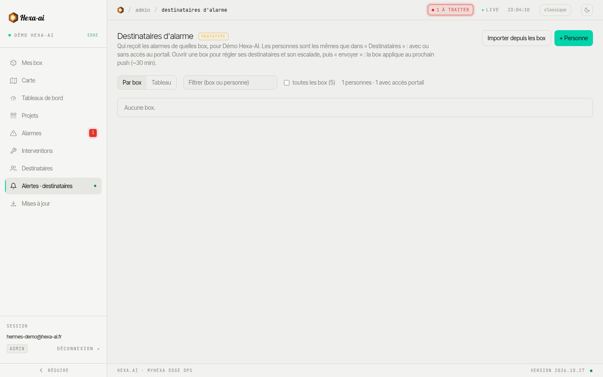

**The boxes notify** people when an alarm occurs. The portal is where you set, in one place for the whole fleet, **who** each box notifies and **how**. It then sends these settings to the boxes.

:::note[Beta feature]
This feature is recent and may still change.
:::

:::note
Only administrators can edit these settings; other users can view them. A box whose software does not allow this remote setting is marked **firmware non compatible** (firmware not compatible).
:::

## People

**+ Personne** (Person) adds someone to notify: name, email, phone number. An on-call person does not necessarily need portal access:

- **Accès au portail : oui** (Portal access: yes): they are invited as a reader or an administrator;
- **Accès au portail : non** (Portal access: no): they only receive the alarms from the boxes that notify them.

**Importer depuis les box** (Import from boxes) picks up the recipients already configured on the boxes.

## Assign people to boxes

- **Par box** (By box) view: for each box, the list of people notified, their channels (**mail**, **SMS**, **appel** (call)) and the alarm types received (error, warning, info).
- **Tableau** (Table) view: all boxes and all people, for bulk settings.
- **Copier les destinataires** (Copy recipients) from one box to other boxes.

## Escalation

For a box, escalation notifies people **in levels**: each level has its own delay; if the alarm is still active once the delay has elapsed, the next level is notified. With no escalation (**immédiat** (immediate) mode), everyone is notified straight away. The delay of each level ranges from 1 to 1,440 minutes, and options let you accumulate levels, stop when the alarm clears, or notify on closure.

## Send to the boxes

Changes only take effect once they are **sent** to the box. Each box's synchronisation status shows whether it has received its recipients.
