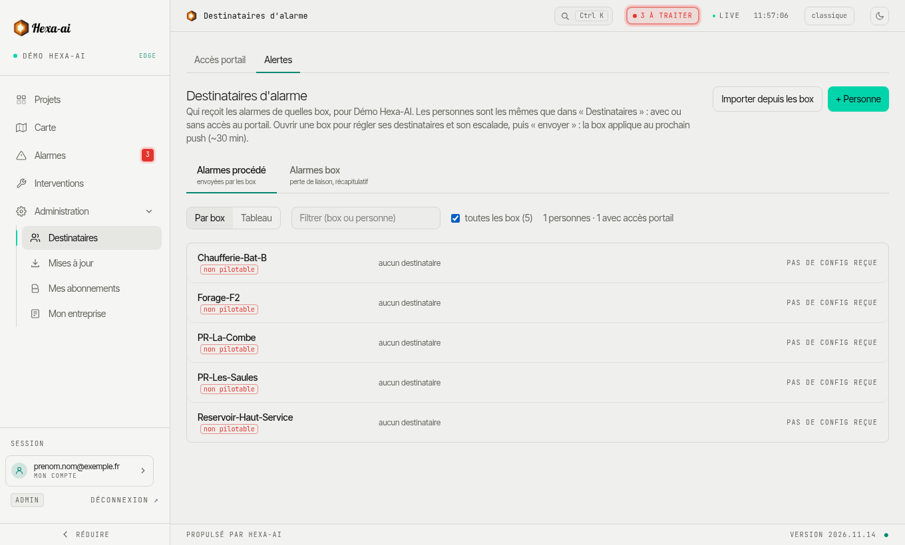

**The boxes notify** people when an alarm occurs. The portal is where you set, in one place for the whole fleet, **who** each box notifies and **how**. It then sends these settings to the boxes.

:::note
Administrators edit all of these settings. A **manager** edits the recipients, escalation, sending, copying and maintenance of the boxes in their scope; other users can view them. A box whose software does not allow this remote setting is marked **firmware non compatible** (firmware not compatible).
:::

This page opens through **Administration ▸ Destinataires ▸ Alertes** tab, which holds two sub-tabs: **Alarmes procédé** (process alarms, sent by the boxes, described below) and **Alarmes box** (box alarms).

## Box alarms: link loss and summary

These e-mails are sent by the **portal**, not by the boxes. The company settings (delay, who receives, summary) are reserved for administrators. Per-box **subscriptions** and **Maintenance** are also open to managers, on the boxes in their scope; other roles can view them.

- **Box link loss**: a box that is cut off cannot warn by itself. The portal sends an e-mail when it has not reported for the chosen **delay** (**4 heures**, **24 heures** or **7 jours**), then another when it is back. One e-mail per person groups the boxes concerned. Choose **who receives** (all administrators, all members, or nobody) and put a box in **Maintenance** to pause its alerts, then **Reprendre** (Resume).
- **Status summary**: an e-mail summarising the state of the boxes (online, offline, active alarms), with a link to the portal.
  - **Fréquence** (Frequency): **jamais** (never), **tous les jours** (daily) or **chaque semaine** (weekly); for a weekly e-mail, choose the **day** (Tuesday by default). This setting applies to the whole company.
  - **Sending time**: the summary is sent early in the morning at a fixed time (around 6 am Paris time in winter, around 7 am in summer). The time cannot be changed.
  - **Recipients**: the people ticked in the list, provided they have portal access. Each person receives the state of the boxes they can see.
  - **AI summary**: the **Ajouter un résumé rédigé par l'IA** (Add an AI-written summary) option sends the boxes' status to Google (Gemini) to write a short summary at the top of the e-mail.

A person without portal access can receive link-loss e-mails (on-call staff, for instance), but not the status summary.

## People

**+ Personne** (Person) adds someone to notify: name, email, phone number. An on-call person does not necessarily need portal access:

- **Accès au portail : oui** (Portal access: yes): they are invited with the chosen role (**Inviter au portail** (Invite to the portal), administrators only);
- **Accès au portail : non** (Portal access: no): they only receive the alarms from the boxes that notify them.

A manager can add, edit and delete people **without** portal access. **Importer depuis les box** (Import from boxes) picks up the recipients already configured on the boxes (administrators only).

## Assign people to boxes

- **Par box** (By box) view: for each box, the list of people notified, their channels (**mail**, **SMS**, **appel** (call)) and the alarm types received (error, warning, info).
- **Tableau** (Table) view: all boxes and all people, for bulk settings.
- **Copier les destinataires** (Copy recipients) from one box to other boxes.

A manager acts only on the boxes in their scope: the other boxes remain view-only.

## Escalation

For a box, escalation notifies people **in levels**: each level has its own delay; if the alarm is still active once the delay has elapsed, the next level is notified. With no escalation (**immédiat** (immediate) mode), everyone is notified straight away. The delay of each level ranges from 1 to 1,440 minutes, and options let you accumulate levels, stop when the alarm clears, or notify on closure.

## Send to the boxes

Changes only take effect once they are **sent** to the box. Each box's synchronisation status shows whether it has received its recipients.
