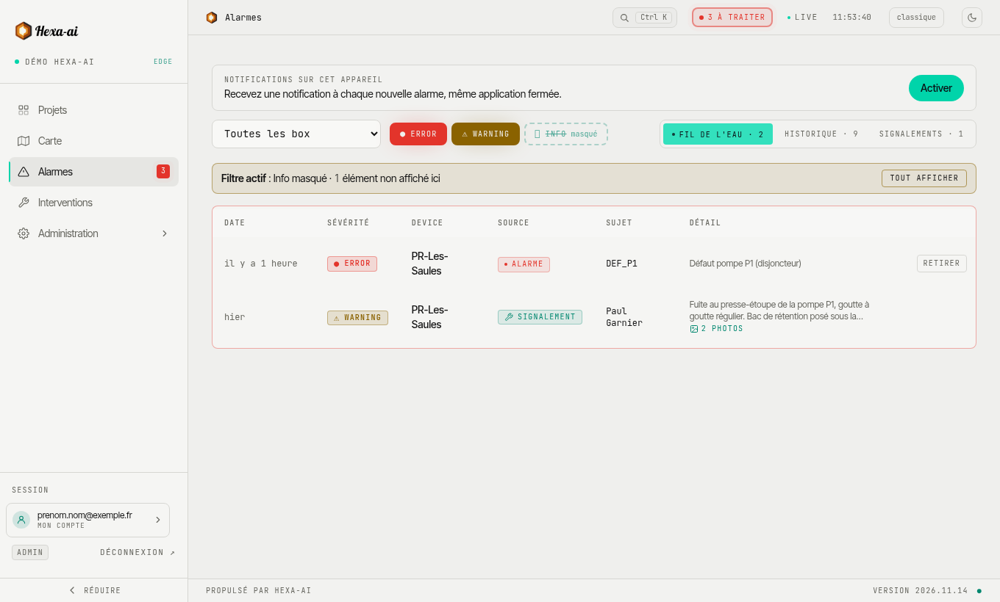

The **Alarmes** (Alarms) page gathers the alarms of all your boxes.

## Three views

- **Fil de l'eau** (Live feed): the **current** alarms, based on the last status sent by each box.
- **Historique** (History): one line per occurrence (start, end, duration, type, description), based on the boxes' daily reports. Alarms from today appear there as soon as they occur, marked **provisoire** (**prov.**, provisional), until the daily report replaces them.
- **Signalements** (Field reports): the faults reported by technicians from the intervention page.

The **Toutes les box** (All boxes) filter and the severities (**Error**, **Warning**, **Info**) apply to all three views.

## Active filter

By default, **Info** severity items are hidden. As soon as a severity is hidden, its button appears **crossed out** and a **Filtre actif** (Filter active) banner shows how many items are not displayed. **Tout afficher** (Show all) restores all severities.

<video class="hai-clip" autoplay loop muted playsinline preload="metadata" poster="/portal/videos/filtre-poster.jpg" aria-label="Filtre actif banner, then Tout afficher, on the Alarms page"><source src="/portal/videos/filtre.webm" type="video/webm"><source src="/portal/videos/filtre.mp4" type="video/mp4"></video>

The portal header always shows the number of alarms **to be handled**, and the **Alarmes** menu entry a red badge.

In a [project](/en/portal/projects/projects/), the **Alarmes** tab shows the alarms of its boxes only, with **Actives**, **Interventions** and **Historique** counters. An alarm left active while the box is lost or dismantled can be removed with the **Retirer** button.

## Notifications

The **Notifications sur cet appareil** (Notifications on this device) panel enables a notification for each new alarm, even when the app is closed. See [Phone app](/en/portal/getting-started/mobile/).
