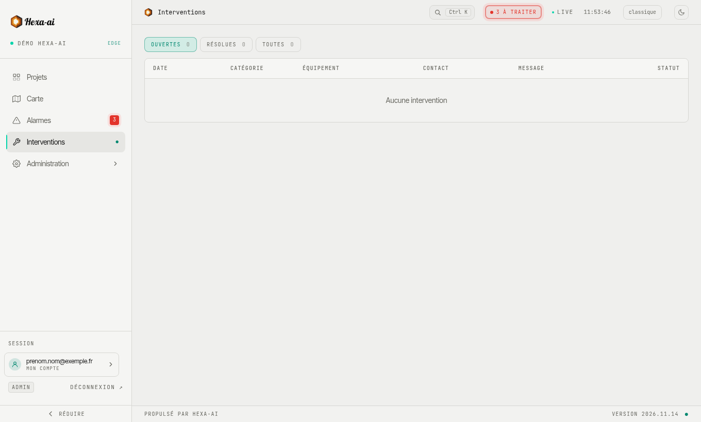

The **Interventions** page is the register of field actions. Reports arrive from each box's public page, opened by its QR code (see [Box page](/en/portal/fleet/device/#intervention-page-and-qr-code)).

For each report: date, category (**Intervention**, **Incident**, **Contrôle** (Check), **Autre** (Other)), the box concerned, the technician and their contact details, message, photos and status.

- **Ouvertes** (Open), **Résolues** (Resolved) and **Toutes** (All) filters.
- Click a line for the details and photos. The register shows the 200 most recent reports and refreshes every minute.
- **Marquer résolue** (Mark as resolved) closes the report; **Rouvrir** (Reopen) puts it back in progress. Both actions are reserved for **Managers** (Gestionnaire) and **Administrators** (within their scope); a Viewer or an Operator only sees the **Ouverte** (Open) or **Résolue** (Resolved) status.

The number of open interventions appears in the menu, next to **Interventions**.
