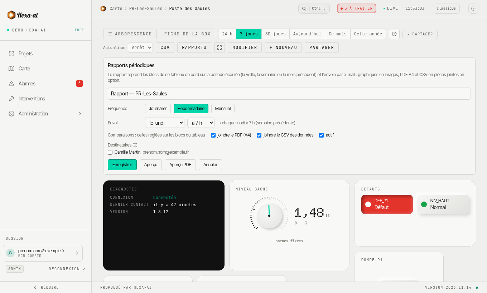

A report automatically emails the content of a dashboard, every day, every week or every month.

## Create a report

1. Open the dashboard, then **Rapports** (Reports).
2. **+ Rapport** (Report) (administrators only), and give it a name.
3. Choose the **frequency** (**Journalier** (Daily), **Hebdomadaire** (Weekly), **Mensuel** (Monthly)), the day (a weekday, or the 1st to the 28th of the month) and the time of sending.
4. Tick the attachments: **PDF** (A4 format) and/or **CSV des données** (data CSV).
5. Select the **recipients** from the people in your company (only people who have an email address can be selected).
6. **Enregistrer** (Save).

The report covers the elapsed period: the previous day for a daily report, otherwise the previous week or month. Comparisons are the ones set on the dashboard blocks.

## Check before sending

- **Aperçu PDF** (PDF preview, in the report editor): downloads the document as it will be sent.
- **Aperçu** (Preview): the email, in **Ordinateur** (Desktop) or **Téléphone** (Phone) version.
- **Envoyer maintenant** (Send now): an immediate send, outside the schedule.

## Logo and tracking

- **Logo des rapports** (Report logo): add your company logo (PNG or JPEG, 2 MB maximum). It is shared across the whole company and appears at the top of the emails and PDFs.
- **Derniers rapports générés** (Latest reports generated; the last 30): period covered, status (sent, archived but not sent, error), recipients, and access to the PDF and CSV of each send.

A report can be disabled without being deleted (untick **actif** (active)); the dashboard of a closed project is read-only, so its reports can no longer be changed.
