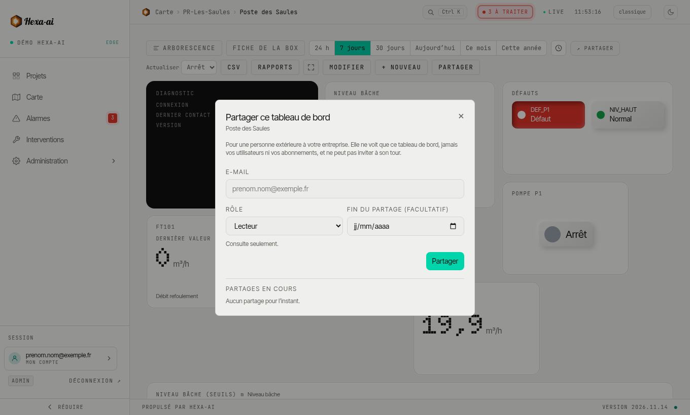

You can show a dashboard to a partner, end client or design office **without opening the rest of your account**.

## Share

1. Open the dashboard, then **↗ Partager** (Share, at the top of the dashboard).
2. Enter the person's **e-mail**, and optionally an **end of sharing**.
3. Confirm: if the person has no myHexa account yet, they receive an invitation by e-mail ("Invitation envoyée à…"); otherwise the dashboard appears in their portal, under **Partagés avec moi** (Shared with me).

The **Partages en cours** (Current shares) list lets you **Retirer** (Remove) access at any time. For a dashboard, the proposed role is **Lecteur** (Viewer): the person views it read-only, without editing or re-sharing it.

## What the invited person sees

- The dashboard, **read-only**: they can neither edit nor re-share it.
- Only the data of the dashboard's blocks: not the box sheet, the full history or your other boxes.
- Only documents placed in a **Documents** block of the dashboard.

Sharing is for administrators of the owning company. The mechanism is the same for a project, a box or a synoptic, with other possible roles: see [Sharing with an outside person](/en/portal/administration/external-sharing/).
