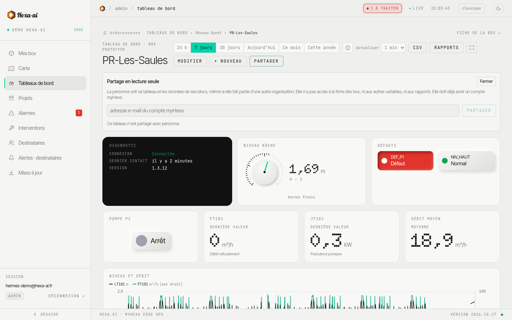

You can show a dashboard to a partner, an end customer or an engineering firm, **without opening up the rest of your account**.

## Share

1. Open the dashboard, then **Partager** (Share).
2. Enter the **email address of the person's myHexa account**.
3. Confirm: the dashboard appears in their portal.

Sharing is restricted to administrators, for dashboards that cover your company's boxes. The person must already have a myHexa account; they find the dashboard under **Partagés avec moi** (Shared with me). A dashboard can be shared with 50 people at most. The **Retirer** (Remove) button cuts off access immediately.

## What the invited person sees

- The dashboard, **read-only**: they can neither edit it nor share it again.
- Only the data of the dashboard's blocks: not the box page, nor the full history, nor your other boxes.
- Only the documents placed in a **Documents** block of the dashboard.

To give access to a whole box, see [Users and access](/en/portal/administration/users/) instead.
