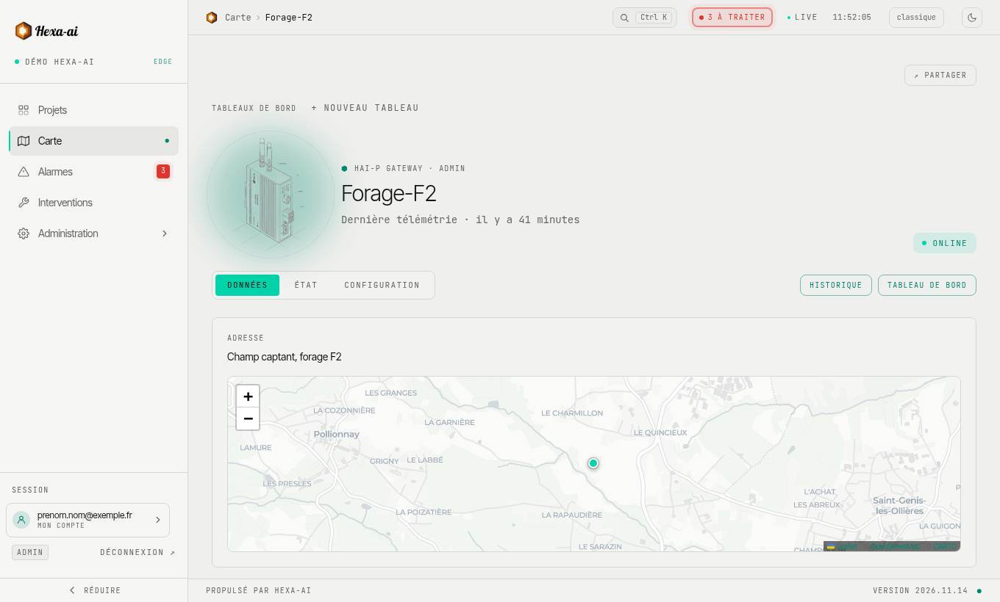
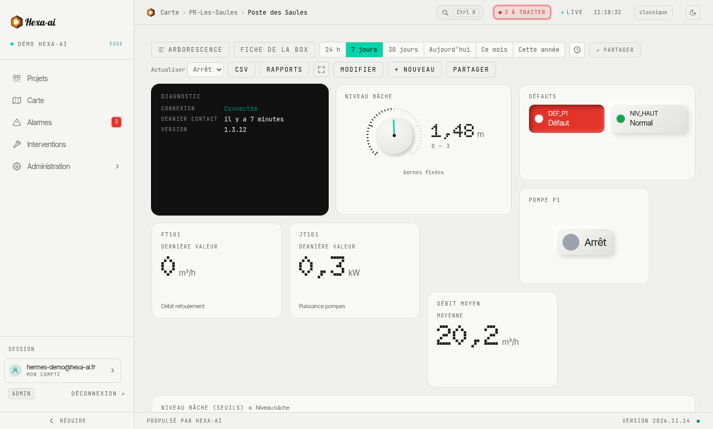

The box page brings together everything about a box.

## Header

When you open a box (from the map, a project or **Ctrl K**), its **default dashboard** is displayed (see [Dashboards](/en/portal/dashboards/dashboards/)), with the period, **Direct** (live) mode, **CSV**, **Rapports**, **Partager** and the **Fiche de la box** (box sheet) button. The sheet shows the box name, its model, the time of the **last telemetry** and its status (**online** / **offline**); the [history](/en/portal/fleet/history/) of its variables opens from the sheet.

## The tabs

- **Données** (Data): address and map, active alarms, then the current values sorted into **Mesures** (Measurements), **Compteurs** (Counters) and **États** (States).
- **État** (Status): software version, uptime, time zone (**Timezone**), network interfaces (Ethernet, Wi-Fi, 4G) and services.
- **Configuration**: the box address, its **field intervention QR code** and, depending on the box, remote access to the PLC screen (VNC). Only administrators can make changes.

## Documents

The sheet also shows the **project's documents** for the box (see [Documents](/en/portal/projects/documents/)). Attach useful documents to the box: **plan électrique** (electrical diagram), **analyse fonctionnelle** (functional analysis), **manuel / notice** (manual / leaflet), **photo installation** (installation photo), or other. Only administrators can add and edit them.

1. In the **Documents** section, click **+ Ajouter** (Add).
2. Choose the file, its type and, if needed, a description.
3. Tick **Accessible via QR code** to make it visible on the intervention page (without logging in).

A document can be switched from public to private (and back) at any time, with the **→ Privé** (→ Private) and **→ Public** buttons.

## Intervention page and QR code

Each box has a public page, opened by scanning its QR code, **without a myHexa account**. You get the QR code from the **Configuration** tab of the box page: print it and stick it on the cabinet. A technician on site can:

- view the documents marked as public;
- report an **intervention** or flag a **fault**: name, email or phone number, severity, category, comment and up to **5 photos** (compressed on the phone before sending).

Reports arrive in [Interventions](/en/portal/alarms/interventions/).

## Share the box with a person

The **↗ Partager** (Share) button gives access to this box alone to someone outside the company, with the **Lecteur** or **Opérateur** role and an optional end date. See [Sharing with an outside person](/en/portal/administration/external-sharing/). To give a colleague access to several boxes, use [roles and scopes](/en/portal/administration/roles/) instead.
