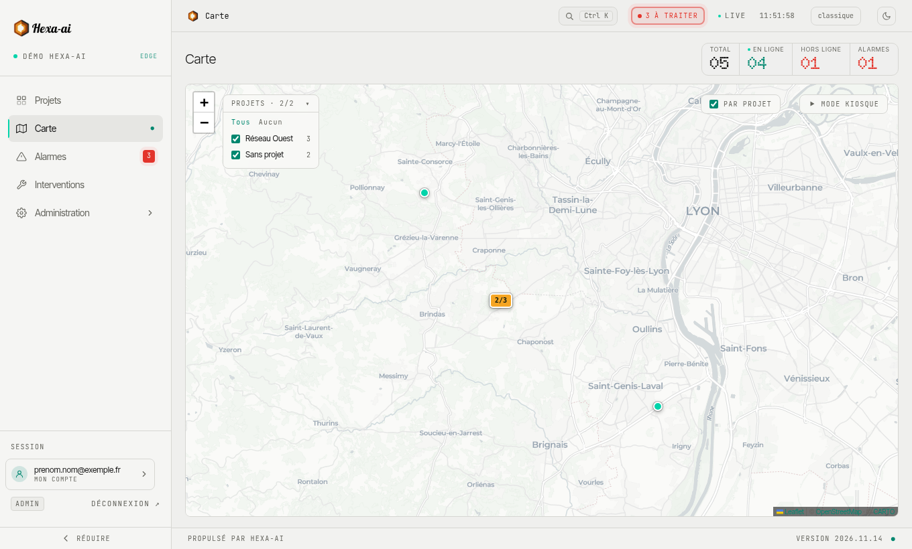

## The map

The **Carte** (Map) page places your boxes on a map, from the address or coordinates entered. At the top right, four counters summarise the fleet: **Total**, **En ligne** (online), **Hors ligne** (offline) and **Alarmes**.

- Boxes of the same [project](/en/portal/projects/projects/) share a single marker, with a summary of their boxes; the **Par projet** (by project) box turns this grouping on or off. Boxes without a project each have their own.
- The **Projets** panel lists your projects: untick some to hide them, **Tous** / **Aucun** (all / none).
- A marker in alarm is flagged; click a marker for the summary, then a box to open its page.
- **Mode kiosque** (kiosk mode) steps through the markers automatically every 12 seconds: handy for a monitoring screen.

The map is the home page of a person who sees no project; otherwise it is the **Projets** page.

## The box list

There is no "Mes box" page any more: the list of your boxes is in each project's **Équipements** tab (and in the [General](/en/portal/projects/projects/#the-general-space) space for boxes without a project), as a list or on a map. For each box: **État** (online if it reported within the hour), **Nom**, **Alarmes**, **Réseau**, **Accès** and **Dernier contact**. The former "Mes box" addresses redirect to the map.

Click a box to open its [page](/en/portal/fleet/device/). You can also find it with **Ctrl K** ([Finding your way around](/en/portal/getting-started/navigation/)).
