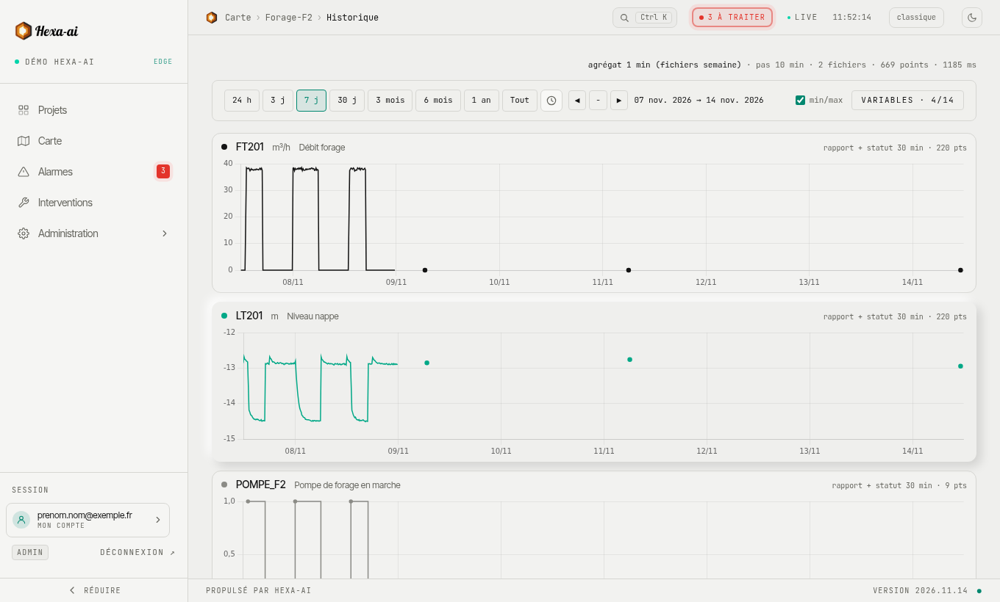

The history shows how a box's variables change over the period of your choice. You reach it with the **Historique** (History) button on the box page.

## Choose what to display

- **Variables**: the **Variables · n/N** button opens the list; tick the ones to display (search by name, **tout cocher** (tick all), **aucune** (none)), up to 40 at a time. Each variable has its own chart, with its unit.
- **Période** (Period): buttons **24 h**, **3 j** (3 d), **7 j** (7 d, the default), **30 j**, **3 mois** (3 months), **6 mois**, **1 an** (1 year), or **Tout** (All) for the whole history. The clock button opens an exact **range** (**Du** (From) and **Au** (To) fields, shortcuts **Hier** (Yesterday), **Semaine dernière** (Last week), **Mois dernier** (Last month), 5 years at most).
- **Navigation**: **◀** and **▶** to move back and forward, **−** to zoom out.
- **min/max**: ticked by default; shows the minimum-maximum envelope in addition to the average, so you do not miss a peak.

## Zoom

On a chart, drag the mouse over the area that interests you, or use the mouse wheel (on a phone, pinch): the period narrows to it and the resolution gets finer. **Shift + drag** moves the period. Hovering shows the exact date and value.

<video class="hai-clip" autoplay loop muted playsinline preload="metadata" poster="/portal/videos/historique-poster.jpg" aria-label="Zooming with the mouse on a history curve"><source src="/portal/videos/historique.webm" type="video/webm"><source src="/portal/videos/historique.mp4" type="video/mp4"></video>

## Long periods: what you see

Over several weeks, a box has recorded far more values than the screen can display. The portal then splits the period into **time buckets** (at most 1,500 per variable) and keeps the **average**, the **minimum** and the **maximum** for each. The curve plots the average; the **min/max** option shows the envelope, so a brief peak stays visible. Counters (volumes, energy) are totalled per hour, per day or per week, depending on the period displayed.

Narrow the period (or zoom in) to get back to point-by-point detail.

## Good to know

- The history depends on what the box records: only variables that are logged on the box appear in it.
- Data arrives in batches: the last few minutes may not be there yet. The live value remains visible on the box page.
