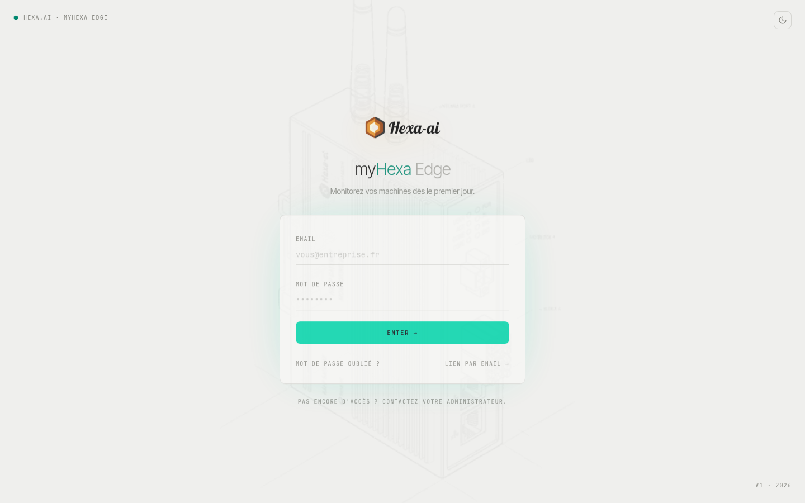

The portal is available at **[my.hexa-ai.fr](https://my.hexa-ai.fr)**, from any recent browser.

## First access: the invitation

You do not create your own account: an administrator of your company (or Hexa-AI during commissioning) invites you.

1. You receive a myHexa invitation email.
2. Click the link: it opens the portal so you can **choose your password**.
3. You land on the list of your boxes.

The invitation link can be used only once and is valid for a limited time. If it has expired or has already been used, the page offers to request a new one. The password must be at least 8 characters long.

:::tip
Open the link directly from the email. A link that was copied incompletely shows "Lien incomplet : ouvrez-le directement depuis le mail" (Incomplete link: open it directly from the email).
:::

## Log in

- **E-mail et mot de passe** (email and password): the usual method.
- **Lien par email** (email link): no password needed; if the address matches an account, you receive a single-use login link.
- **Mot de passe oublié ?** (forgot your password?): you receive a link to choose a new one.

No access yet? Ask your company's myHexa administrator.

## What you see

What the portal shows depends on your role:

- **Viewer** (reader): views the boxes, history, dashboards and alarms within their scope.
- **Admin**: can also invite users, build dashboards and reports, edit alarm recipients and start box updates.

See [Users and access](/en/portal/administration/users/).
