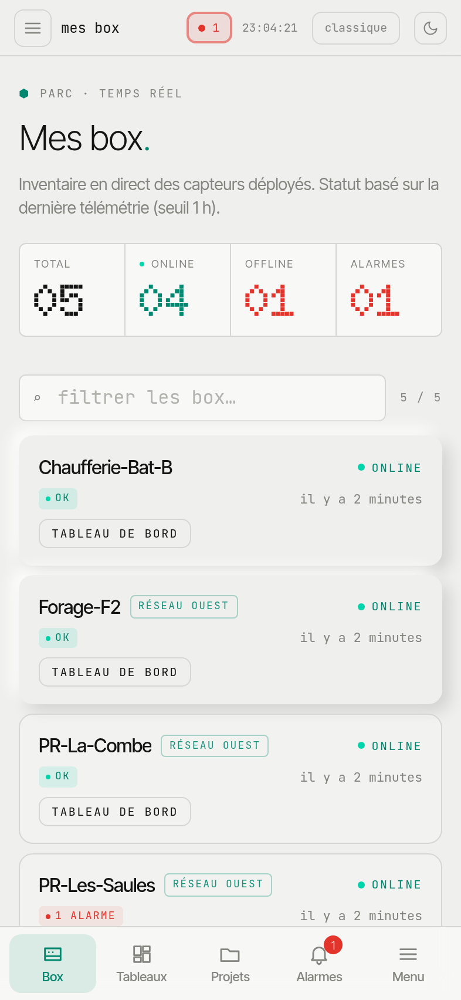

myHexa installs like an app, without going through an app store. Once installed, it opens full screen and can notify you of new alarms.

## Install the app

**On iPhone (Safari)**

1. Open [my.hexa-ai.fr](https://my.hexa-ai.fr) in **Safari** and log in.
2. Tap **Partager** (Share), then **Sur l'écran d'accueil** (Add to Home Screen).
3. Open myHexa from the new icon.

**On Android (Chrome)**

1. Open [my.hexa-ai.fr](https://my.hexa-ai.fr) in **Chrome** and log in.
2. In the **⋮** menu, choose **Installer l'application** (Install app) (or **Ajouter à l'écran d'accueil**, Add to Home screen).

On a phone, a tab bar at the bottom of the screen gives access to **Box**, **Tableaux** (Dashboards), **Projets** (Projects), **Alarmes** (Alarms) and the full **Menu**.

## Receive alarms as notifications

1. Open the **Alarmes** (Alarms) tab.
2. In the **Notifications sur cet appareil** (Notifications on this device) panel, tap **Activer** (Enable) and accept the phone's request.

You are then notified of **every new alarm on your boxes**, even when the app is closed. The setting applies to this device: enable it on each phone or computer concerned.

:::note
On iPhone, notifications require iOS 16.4 or later, and only work with the app installed on the home screen (not in a Safari tab).
:::

:::caution
These notifications are a convenience for monitoring. The official forwarding of alarms (SMS, email) is done **by the box** to its recipients: see [Alarm recipients](/en/portal/alarms/alarm-recipients/).
:::
