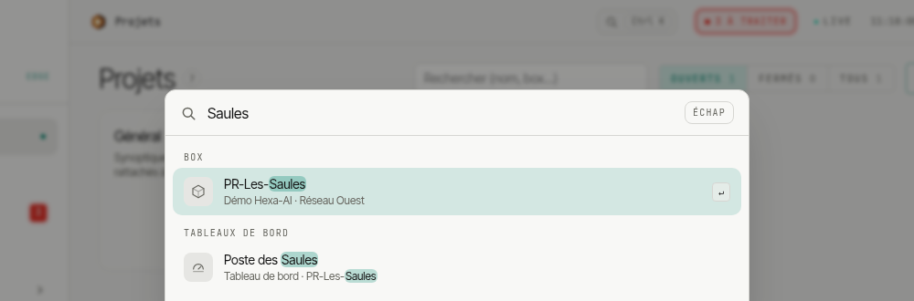
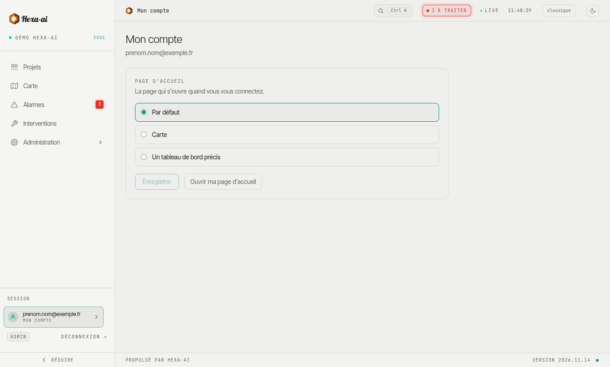

## The menu

The left menu gives access to the portal pages. What you see depends on your [role](/en/portal/administration/roles/) and on what you follow:

| Entry | What for |
|---|---|
| **Projets** (Projects) | Projects, their dashboards, synoptics and documents. See [Projects](/en/portal/projects/projects/). |
| **Carte** (Map) | All your boxes on a map. See [Map and boxes](/en/portal/fleet/fleet/). |
| **Alarmes** (Alarms) | The alarms of all your boxes. A red badge gives the number of alarms to handle. See [Alarms](/en/portal/alarms/alarms/). |
| **Interventions** | The register of field reports. See [Interventions](/en/portal/alarms/interventions/). |
| **Administration** | **Destinataires** (Recipients), **Mises à jour** (Updates), **Mes abonnements** (My subscriptions), **Mon entreprise** (My company), depending on your rights. |

If your company has no box yet (a client whose project is handled with Hexa-AI, for example), the menu shrinks to **Projets**. The former "Mes box" and "Tableaux de bord" addresses redirect to **Carte** and **Projets**: your bookmarks still work.

At the bottom of the menu, **Mon compte** (My account) opens your settings, **Déconnexion** (Sign out) ends the session and **Réduire** (Collapse) folds the menu. The moon button at the top right switches between light and dark theme. The header also shows the number of alarms **à traiter** (to handle), the **Live** indicator and the time.

## Quick search: Spotlight

Press **Ctrl K** (**⌘ K** on Mac), or click the **Ctrl K** field in the header, from any page. Type a few letters: the Spotlight searches your pages, boxes, dashboards, synoptics, projects, documents and variables.

<video class="hai-clip" autoplay loop muted playsinline preload="metadata" poster="/portal/videos/spotlight-poster.jpg" aria-label="Ctrl K opens the Spotlight, type Saules, pick the box, the box page opens"><source src="/portal/videos/spotlight.webm" type="video/webm"><source src="/portal/videos/spotlight.mp4" type="video/mp4"></video>

- With no input, it first proposes what relates to the current page (**Ici**, "here"), then your **Récents** (recent items).
- **↑ ↓** to move, **↵** to open, **Ctrl ↵** to open in a new tab, **Esc** to close.
- It only offers what you are allowed to see: never a page missing from your menu.

## My account and landing page

**Mon compte** (bottom of the menu) lets you choose the **home page**: the one that opens when you sign in.

- **Par défaut** (default): the **Projets** page (the **Carte** if you see no project); a client with no box and a single project lands directly on it;
- **Carte**;
- **a specific dashboard**, chosen from the list: for example for a monitoring screen.

**Enregistrer** (Save) validates your choice, **Ouvrir ma page d'accueil** shows it immediately. If the chosen dashboard disappears or becomes inaccessible, you land on the default page. An administrator can also set another user's home page ([Users and access](/en/portal/administration/users/)).
