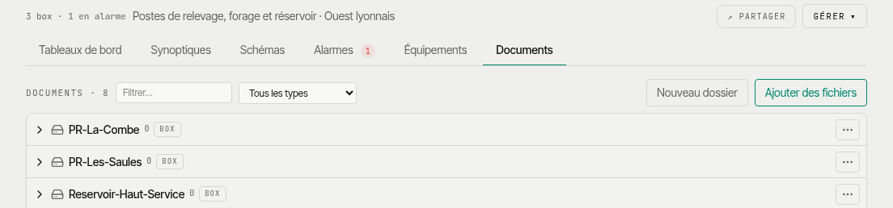

A project's **Documents** tab is an explorer: one folder per box of the project, plus your own folders and files (plans, manuals, analyses, photos, reports…).

## Browse

- The **Filtrer…** (Filter) field and the **Tous les types** (all types) list narrow the display.
- Each box of the project has its folder (tagged **BOX**) holding the documents attached to that box.
- Clicking a file opens it in the viewer, with **Télécharger** (Download) and **Nouvel onglet** (New tab). The **⋯** menu of each row offers the other actions, according to your rights.

## Add

- **Ajouter des fichiers** (Add files): pick files on your computer.
- **Nouveau dossier** (New folder): build the tree you need (a box folder holds no subfolder: a box stands alone).
- You can also **drag files onto a folder** to drop them in.

When adding, set the **Titre**, **Type** and **Visibilité**; the **Public** box makes the document readable without signing in from the box's intervention page (QR code). Adding, moving and deleting depend on your role ([Roles and scopes](/en/portal/administration/roles/)); a **Lecteur** (Viewer) or **Opérateur** (Operator) browses and downloads.

## Find a document

The [Spotlight](/en/portal/getting-started/navigation/#quick-search-spotlight) (**Ctrl K**) also searches the title of the documents of all your projects.

## A box's documents

Documents can also be attached to a box from its sheet (**Données** tab) and made available by QR code to on-site technicians: see [Box page](/en/portal/fleet/device/).
