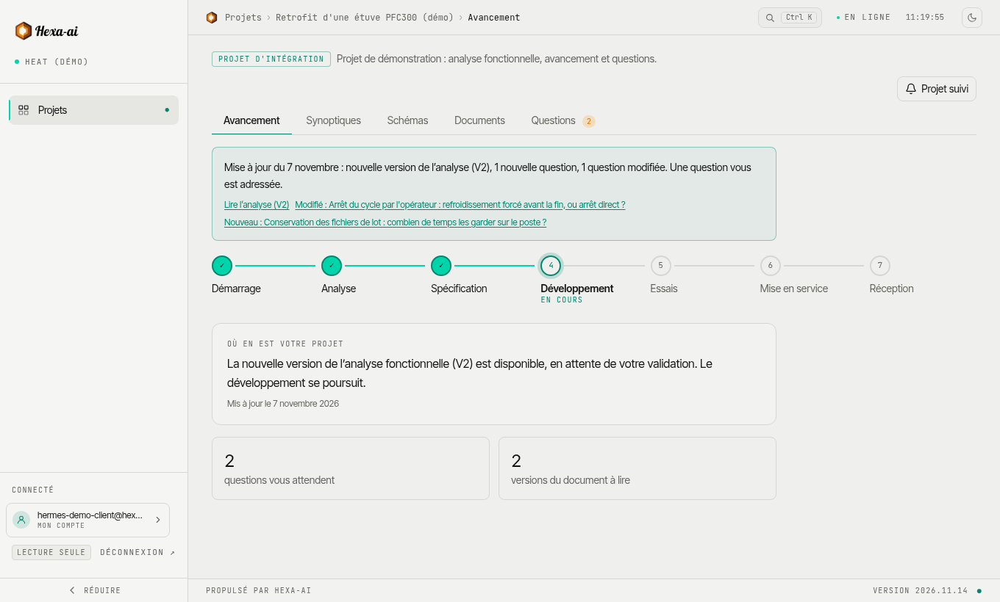
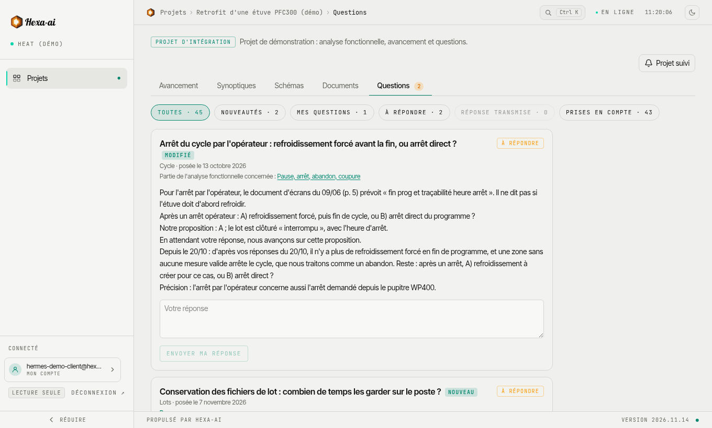

When Hexa-AI builds your installation, your project carries the **Projet d'intégration** (integration project) tag. You follow the work there instead of exchanging files by e-mail. These projects are created by Hexa-AI and visible only to the people you agreed on with us.

:::note
Your view is **read-only**, except for answering and commenting on questions. If you have no box, the menu shrinks to **Projets**; with a single project, signing in takes you straight to it.
:::

## Progress

The **Avancement** (Progress) tab shows where your project stands across seven stages: **Démarrage** (Start), **Analyse**, **Spécification**, **Développement**, **Essais** (Tests), **Mise en service** (Commissioning), **Réception** (Acceptance). The **Où en est votre projet** (Where your project stands) box summarises the situation in one sentence, with its update date. A news banner lists what changed (new document version, new or edited question) with direct links, and two counters show the **questions waiting for you** and the **document versions to read**.

## Answer questions

When the team needs a detail, it asks a question in the **Questions** tab (a counter shows those waiting for you). Filter by **Toutes** (all), **Nouveautés** (news), **Mes questions**, **À répondre** (to answer), **Réponse transmise** (answer sent) or **Prises en compte** (taken into account).

1. Open the question: the text, the relevant part of the functional analysis and the proposals are shown.
2. Write in **Votre réponse** (Your answer), then **Envoyer ma réponse** (Send my answer).

Your answer reaches us and the question moves to **Réponse transmise**. It **stays open** until Hexa-AI takes it into account: you can add a precision at any time.

## Documents

The **Documents** tab has two views: **Fichiers** (the project's files) and **Analyse fonctionnelle** (the functional analysis text, published section by section). The **Synoptiques** and **Schémas** tabs show what Hexa-AI published there.

## Follow the project by e-mail

The **Projet suivi** (Project followed) button at the top right subscribes you to news: you get **at most one summary e-mail per day**. A question addressed to you always reaches you, followed or not. Click again to stop. An administrator can also set each person's follow-up in **Administration ▸ Destinataires**.
