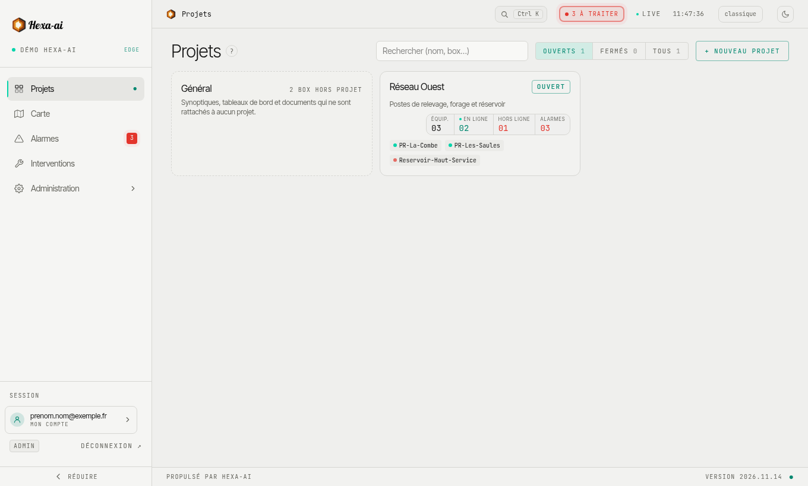
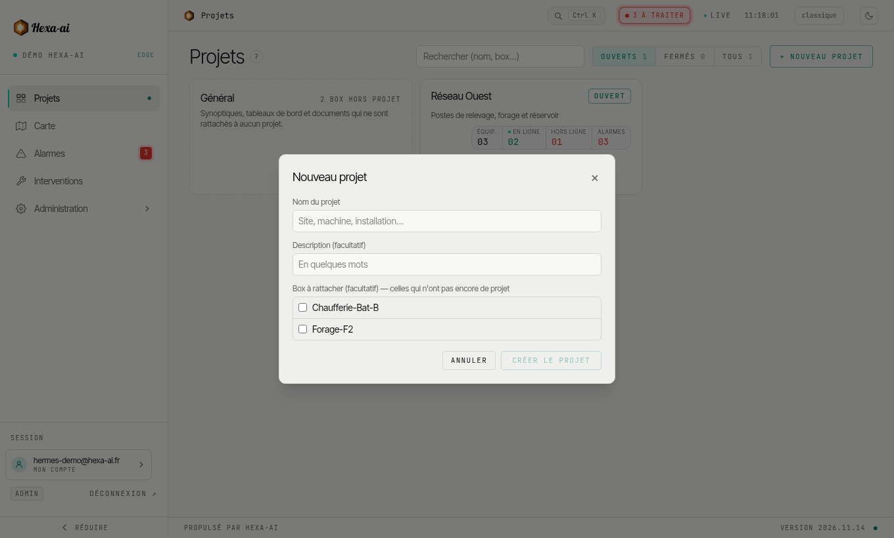
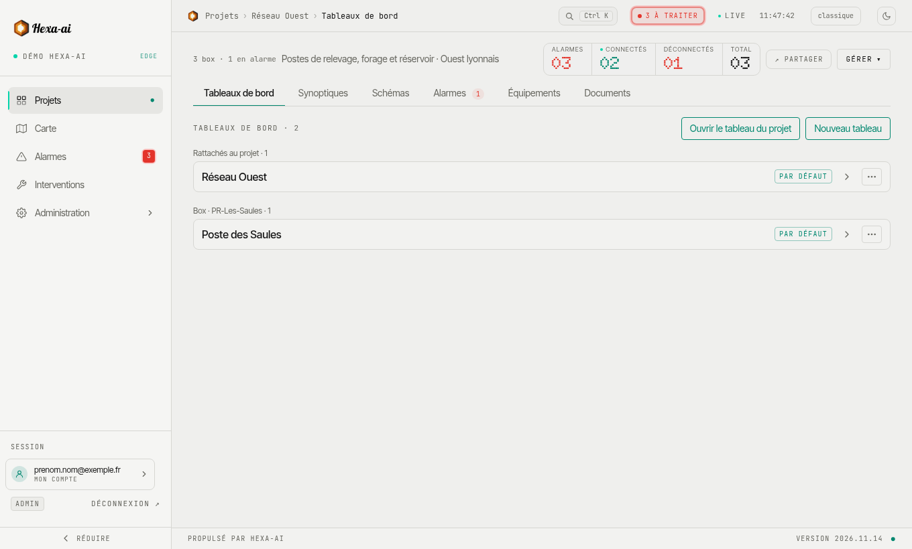
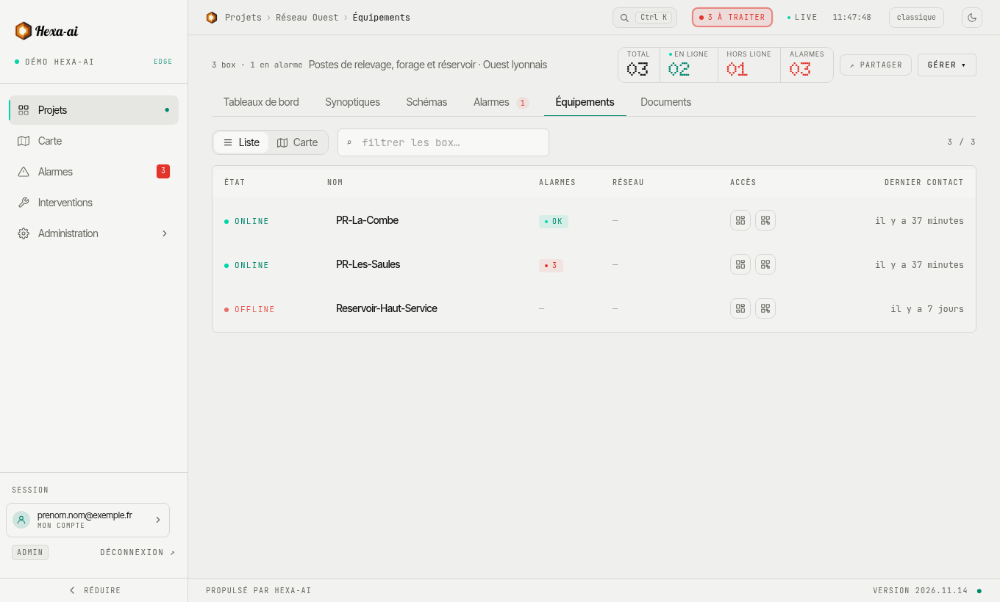
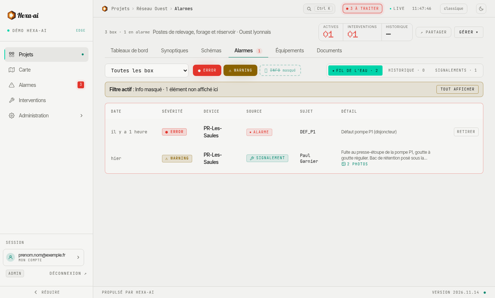
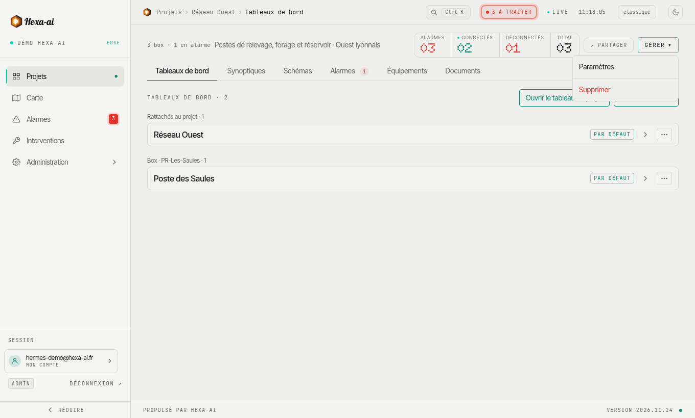
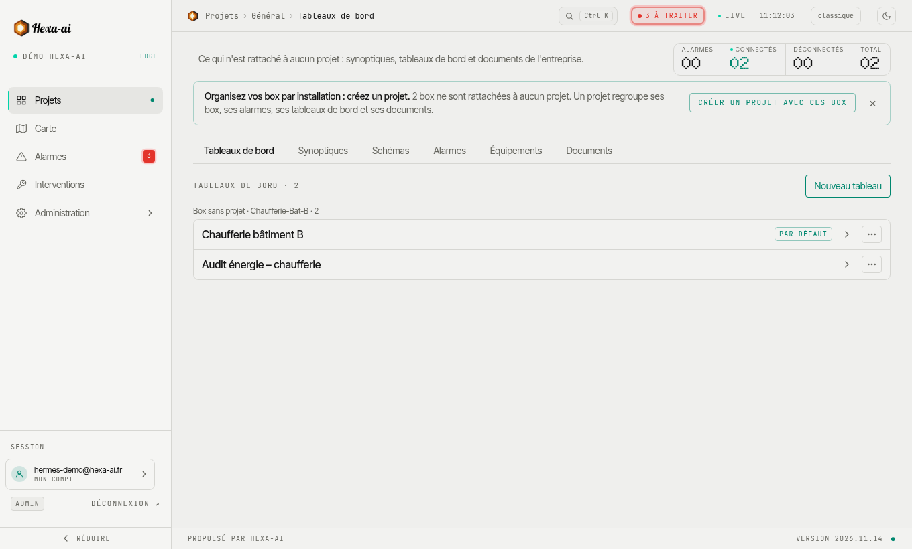

A **project** (**projet**) groups the boxes of one site or machine, with a marker on the map, shared dashboards, synoptics and documents. It is the entry point of the portal. The portal interface is in French; labels are given in French in bold, with an English gloss on first use.

## The project list

The **Projets** (Projects) page, first in the menu, shows one card per project: name, description, the counters **Équip.** (equipment), **En ligne** (online), **Hors ligne** (offline) and **Alarmes**, and its boxes. The search field filters by project or box name; the **Ouverts** (open), **Fermés** (closed) and **Tous** (all) buttons filter by status.

The **Général** card is special: it gathers everything not attached to any project (see [the General space](#the-general-space)).

## Create a project

The **+ Nouveau projet** (New project) button is for administrators and managers (see [Roles and scopes](/en/portal/administration/roles/)).

1. Click **+ Nouveau projet**.
2. Enter the **project name** (site, machine, plant…) and optionally a description.
3. Tick the **boxes to attach**: only boxes without a project are offered.
4. Click **Créer le projet** (Create the project).

A box belongs to one project or none. You can add or remove boxes later in the project settings.

## A project page

Clicking a card opens the project. At the top: its description, the counters and two buttons, **Partager** (Share, see [Sharing with an outside person](/en/portal/administration/external-sharing/)) and **Gérer** (Manage). Below, the tabs:

| Tab | What you find |
|---|---|
| **Tableaux de bord** (Dashboards) | The project's and its boxes' dashboards; **Ouvrir le tableau du projet** and **Nouveau tableau**. See [Dashboards](/en/portal/dashboards/dashboards/). |
| **Synoptiques** (Synoptics) | The animated diagrams (HMI) of the project, in folders. See [Synoptics](/en/portal/synoptics/synoptics/). |
| **Schémas** (Diagrams) | Static diagrams (electrical, for instance), also in folders. |
| **Alarmes** (Alarms) | The project's alarms: active, history, field reports (see [Alarms](/en/portal/alarms/alarms/)). A badge shows the number of active alarms. |
| **Équipements** (Equipment) | The project's boxes, as a list or on the map: status, alarms, network, last contact. |
| **Documents** | The project's document explorer. See [Documents](/en/portal/projects/documents/). |

## Manage a project

The **Gérer** button opens a menu: **Paramètres** (Settings) and **Supprimer** (Delete).

Settings let you change the name, description and address, attach or remove boxes, adjust the map framing, add a project logo (shown on the cover page of printed dossiers) and **close** the project: a closed project stays readable, read-only. Only company administrators (and Hexa-AI) change these settings.

**Delete the project** removes its dashboards and documents; boxes and synoptics become "without project" again.

## The General space

The **Général** space is a "virtual" project: it holds what is attached to no project (the company's synoptics, dashboards and documents). It has the same tabs as other projects. When some boxes have no project yet, a banner offers **Créer un projet avec ces box** (Create a project with these boxes).

## Projects handled with Hexa-AI

Some projects are handled with Hexa-AI: your contact will walk you through how it works.
