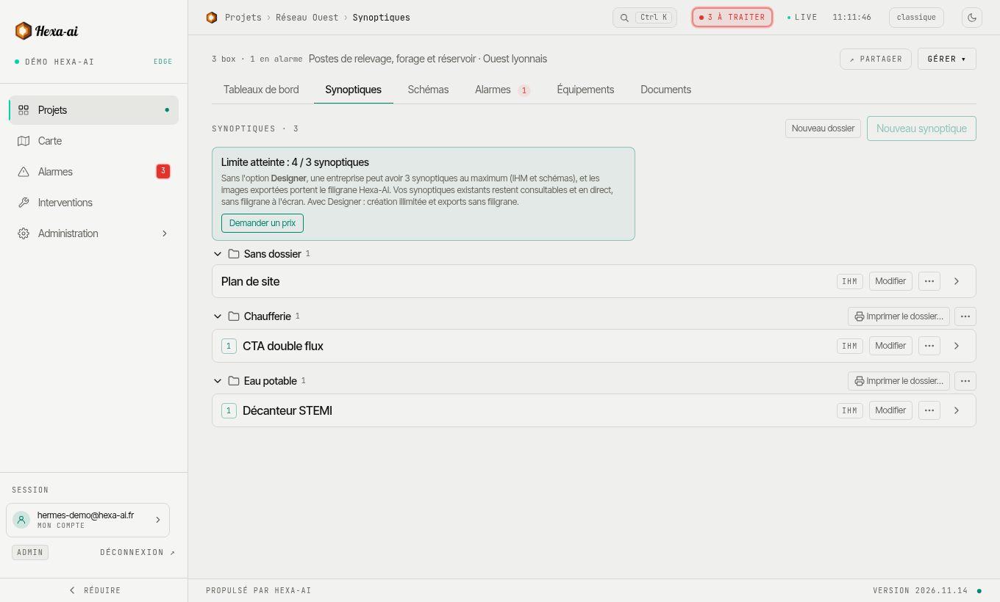

The **Designer** is the option that lets you draw **your own** synoptics and diagrams in the portal. Hexa-AI can also prepare them for you.

## With or without the option

| | Without the Designer option | With the Designer option |
|---|---|---|
| View synoptics, live | yes | yes |
| Edit existing synoptics | yes (administrators and managers) | yes |
| **Create** synoptics and diagrams | up to a limit (3 by default) | **unlimited** |
| Exported files (images, PDF, HMI export) | carry the "my.hexa-ai.fr" watermark | **no watermark** |

The limit is counted across the company (HMI synoptics and diagrams together). Hexa-AI can change it for your company. The watermark is never added **on screen**, only in produced files.

## Where to see the option's status

- On the **Mes abonnements** page: an **Option Designer** card shows the limit and the end date (see [My subscriptions](/en/portal/administration/subscriptions/)).
- In the **Synoptiques** and **Schémas** tabs, a banner appears when the limit is reached.
- Before an export, a notice reminds you that the file will carry the watermark.

## Ask for the option

The **Demander un prix** (Ask for a quote) button, in the banner, the subscriptions page or the export notice, sends your request to Hexa-AI with an optional comment (number of synoptics, need, deadline). Hexa-AI answers by e-mail. The button is for the company's users.

A reminder is sent as the end date approaches. To renew, contact Hexa-AI.
