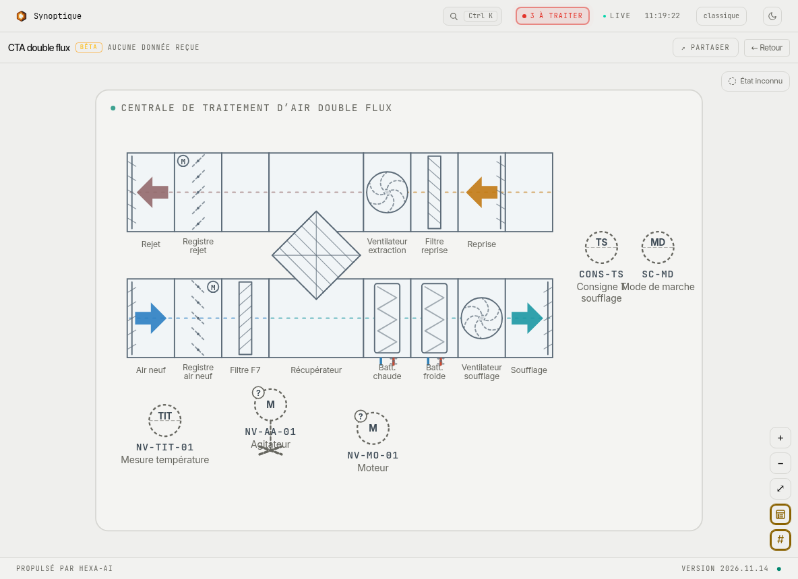
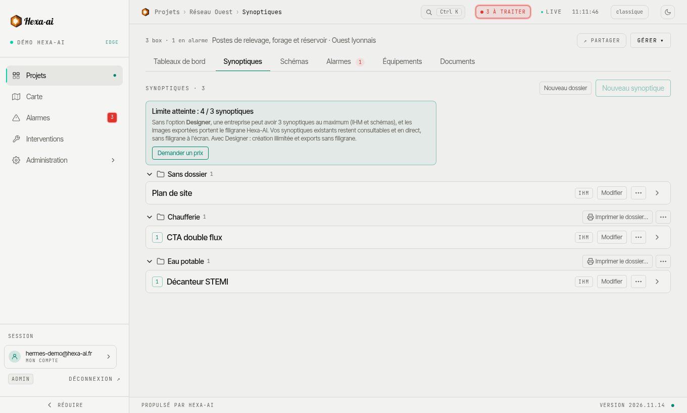
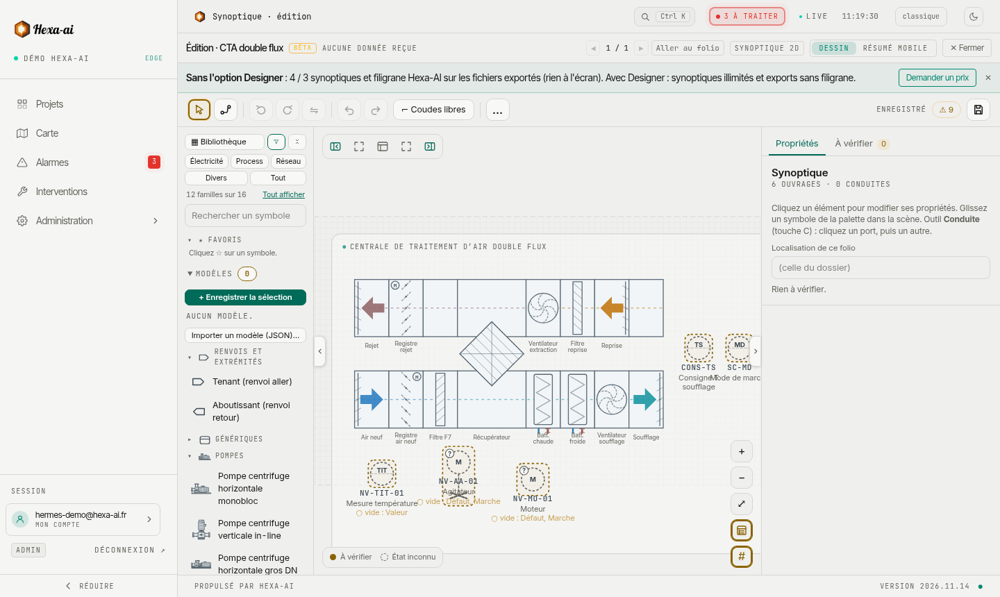

A **synoptique** (synoptic) is the animated diagram of your installation: tanks, pumps, valves, pipes, measures. Each element is linked to box variables, so the diagram is live: a pump changes colour when it starts, a value appears next to its sensor.

:::note[Beta feature]
Synoptics, the Designer and their exports are open to all companies but still evolving. Your feedback is welcome.
:::

## View

Every member of the company can view synoptics:

- in a project's **Synoptiques** (or **Schémas**) tab: click one to open it full frame;
- in a dashboard, with the **Synoptique (bêta)** block;
- from the [Spotlight](/en/portal/getting-started/navigation/#quick-search-spotlight).

Full frame, **+** and **−** zoom, **⤢** fits the view, **← Retour** (Back) returns. **↗ Partager** lets you [give access](/en/portal/administration/external-sharing/) to this synoptic alone.

Depending on the synoptic, a **2D / Iso** toggle and a **3D** button change the representation: the same drawing flat, isometric or in 3D.

## Lists: folders and sheets

In a project, synoptics are sorted into **folders**. A folder groups the **folios** (sheets) of one set, like the pages of a drawing set: each sheet shows its number before its name. The **IHM** (HMI) and **SCHÉMA** tags tell the two kinds apart: a **synoptic (HMI)** is animated by box variables; a **diagram** is a static drawing, such as an electrical diagram.

A synoptic's **⋯** button offers, depending on your rights: rename, move to another folder, attach to another box, change the sheet number, turn into a diagram, delete. A deleted synoptic stays **30 days** in the library bin, then is purged; **Restaurer** (Restore) puts it back, including in the dashboards that used it.

**Imprimer le dossier…** (Print the dossier, folder menu) produces a single PDF; see [Layout, printing and export](/en/portal/synoptics/export/).

## Draw: the Designer

Administrators and managers can edit synoptics: **Modifier** (Edit) button, or **Nouveau synoptique** / **Nouveau dossier** / **Importer un JSON** to create. The editor is for **computers** (large screen and mouse); on a phone or tablet, synoptics stay viewable.

In the editor:

1. the left **Bibliothèque** (Library) offers symbols grouped as **Électricité**, **Process**, **Réseau** and **Divers** (pumps, valves, sensors, references…). Click a symbol to place it, or star it ★ to find it in your **Favoris**;
- **Modèles** (templates) in the library (**+ Enregistrer la sélection**, **Importer un modèle (JSON)…**) reuse an assembly of elements;
2. the **Relier deux ports** (connect two ports) tool draws pipes and wires; **Coudes libres** and **Figer les coudes** set how routes behave when you move equipment;
3. the **Propriétés** panel (right) links the symbol to box **variables**, which is what animates it;
4. the toolbar also offers rotation, mirror, alignment, grid, undo/redo; the **…** button gives access to layout and export;
5. **Enregistrer** (Save) keeps a new version.

The editor's Spotlight (**Ctrl K** inside the editor) searches a symbol, an element or a variable in the synoptic.

## Create as many as you want

How many synoptics you can **create** depends on the **Designer** option of your subscription: see [The Designer option](/en/portal/synoptics/designer/). Without it, you can still view and edit existing ones.
