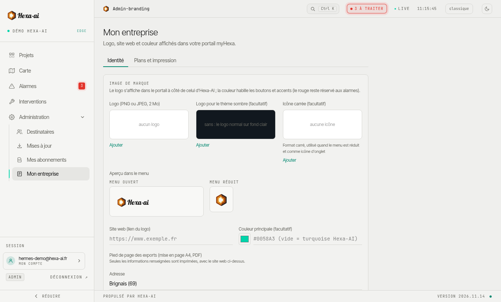
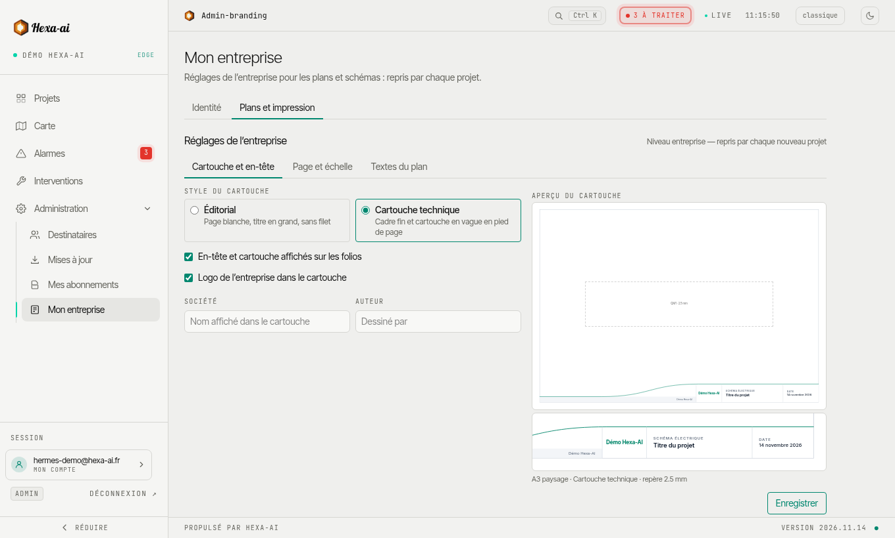

La page **Mon entreprise** (menu **Administration**, visible des administrateurs) a deux onglets : **Identité** et **Plans et impression**.

## Identité

L'**image de marque** habille votre portail : le **logo** s'affiche à côté de celui d'Hexa-AI (PNG ou JPEG, 2 Mo), avec une variante facultative pour le **thème sombre** et une **icône carrée** utilisée quand le menu est réduit et comme icône d'onglet. Le **site web** devient le lien du logo. La **couleur principale** colore les boutons et accents (le rouge vif reste réservé aux alarmes : il n'est pas appliqué). Un aperçu montre le menu ouvert et réduit.

Le **pied de page des exports** (mise en page A4, PDF) imprime, en plus du site web, l'adresse, le téléphone, l'e-mail de contact et jusqu'à 3 lignes libres (SIRET, mention légale, slogan…). Seules les informations renseignées sont imprimées.

## Plans et impression

Ces réglages s'appliquent à tous vos schémas et sont repris par chaque projet :

- **Style du cartouche** : **Éditorial** (page blanche, titre en grand, sans filet) ou **Cartouche technique** (cadre fin et cartouche en vague en pied de page) ;
- **En-tête et cartouche affichés sur les folios**, **logo de l'entreprise dans le cartouche**, **Société** et **Auteur** ;
- **Page et échelle**, et **Textes du plan** : tailles de texte en millimètres de papier (repère d'appareil, libellés et fils, bornes et ports), identiques en A4 et en A3 ;
- un **aperçu du cartouche** se met à jour en direct.

**Enregistrer** applique les réglages. Le titre du projet, le préfixe, l'indice et la date de révision se règlent ensuite par dossier : voir [Mise en page, impression et export](/portal/synoptics/export/).
