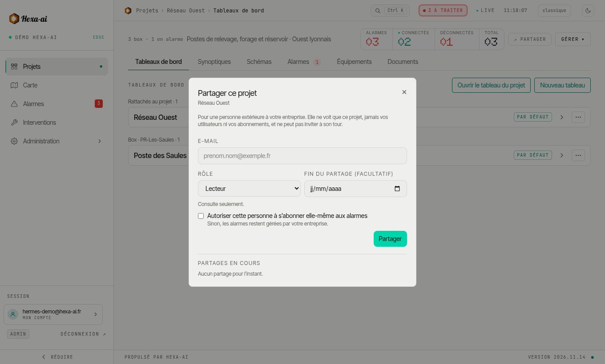

Vous pouvez montrer une partie de votre portail à une personne extérieure à votre entreprise (partenaire, client final, bureau d'études, sous-traitant), **sans lui ouvrir le reste**.

## Partager

Le bouton **↗ Partager** se trouve sur la page d'un **projet**, d'une **box**, d'un **synoptique** et d'un **tableau de bord**.

1. Cliquez sur **Partager**.
2. Saisissez l'**e-mail** de la personne.
3. Choisissez son **rôle** :
   - pour un projet : **Lecteur**, **Opérateur** ou **Gestionnaire** (voir [Rôles](/portal/administration/roles/)) ;
   - pour une box : **Lecteur** ou **Opérateur** ;
   - pour un synoptique : **Lecteur** ou **Modification de cet élément** (modifier ce synoptique, rien d'autre) ;
   - pour un tableau de bord : **Lecteur**.
4. Indiquez, si vous le souhaitez, une **fin du partage** : l'accès s'arrête seul à cette date.
5. Pour un projet ou une box, cochez **Autoriser cette personne à s'abonner elle-même aux alarmes** si elle doit les recevoir (sinon, les alarmes restent gérées par votre entreprise).
6. **Partager**.

La liste **Partages en cours** montre qui a accès, avec son rôle et sa date de fin, et permet de **Retirer** un accès à tout moment : il est coupé immédiatement.

Le partage est réservé aux administrateurs de l'entreprise. La vue d'ensemble de tous vos partages est dans **Destinataires ▸ Accès portail ▸ Partages**.

## Ce que voit la personne invitée

- Uniquement l'élément partagé, avec le rôle choisi : jamais le reste de votre entreprise, et jamais vos utilisateurs ni vos abonnements.
- Un lecteur ne modifie rien et ne peut pas repartager.
- La personne retrouve ce qu'on lui a partagé dans **Partagés avec moi** (entrée du menu, visible dès qu'un partage est actif), classé par entreprise.

## Voir ce qui est partagé avec vous

Si une autre entreprise vous a partagé un élément, la page **Partagés avec moi** le liste ; cliquez pour l'ouvrir. Si rien n'est partagé, la page indique : « Rien n'est partagé avec vous pour l'instant ».
