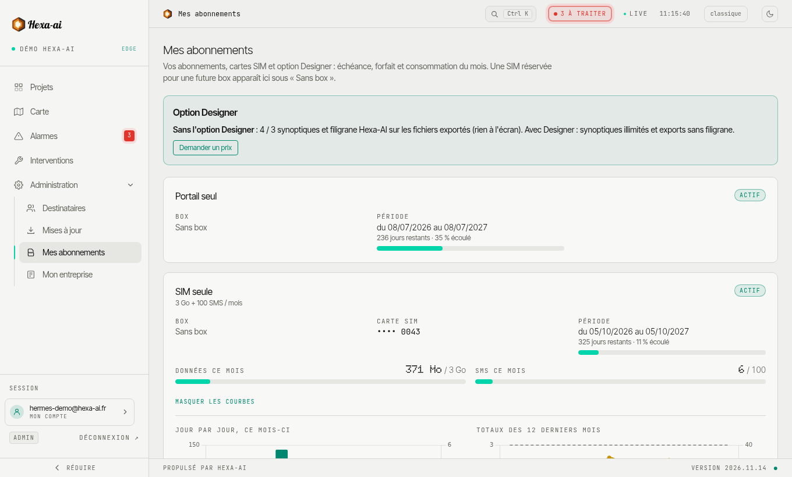

La page **Mes abonnements** (menu **Administration**) regroupe ce qui est souscrit pour votre entreprise : l'abonnement au portail, les cartes SIM des box et l'option Designer.

Pour chaque abonnement :

- le **type** (portail seul, SIM seule, option Designer…) et son état (**Actif**) ;
- la **box** concernée (ou **Sans box** : une SIM réservée pour une future box apparaît ainsi) ;
- la **période** (dates de début et de fin), avec les jours restants et une barre de progression ;
- pour une **carte SIM** : le forfait (ex. 3 Go · 100 SMS / mois), les **données** et les **SMS** consommés ce mois-ci, et une courbe jour par jour (**Masquer les courbes** pour la replier).

Pour l'**option Designer**, la carte indique la limite de synoptiques et, si l'option n'est pas active, propose **Demander un prix** (voir [L'option Designer](/portal/synoptics/designer/)).

Les abonnements ne se modifient pas ici : **pour renouveler ou changer de forfait, contactez Hexa-AI**. L'entrée de menu apparaît pour les administrateurs, et pour les autres rôles dès qu'un abonnement est visible.
