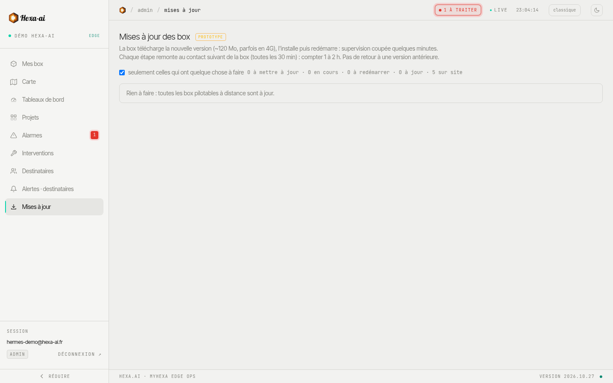

La page **Mises à jour** liste vos box, leur version et la version disponible, et permet de les mettre à jour à distance.

:::note[Fonction en version bêta]
Cette fonction est récente et peut encore évoluer.
:::

:::note
Seul un administrateur de votre entreprise peut lancer une mise à jour.
:::

## Lancer une mise à jour

1. Cochez les box à mettre à jour (ou **tout cocher**). L'option « seulement celles qui ont quelque chose à faire » masque les box déjà à jour.
2. **Mettre à jour la sélection**, vérifiez le récapitulatif (version actuelle → nouvelle version), puis **Lancer la mise à jour**.

## Avant de lancer

:::caution
- La box **redémarre** à la fin : supervision et alarmes sont coupées **quelques minutes**.
- La confirmation peut prendre **1 à 2 heures** : ne concluez pas à un échec avant.
- Il n'y a **pas de retour** à la version précédente.

Choisissez un moment où une courte coupure de la supervision est acceptable.
:::

## Box concernées

Seules les box en version **1.3.7 ou plus**, avec le pilotage à distance activé, se mettent à jour depuis le portail. Les autres sont indiquées **mise à jour sur site**.

Une box sans nouvelles depuis plus de 2 heures est signalée : la mise à jour ne l'atteindra qu'à sa reconnexion. Tant qu'elle n'a pas encore été transmise à la box, une mise à jour programmée peut être annulée.
