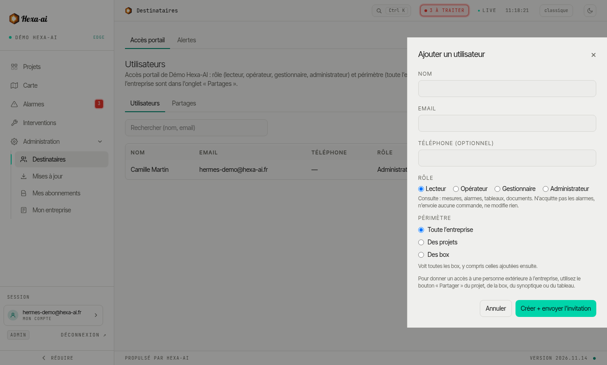

La page **Destinataires** (menu **Administration**), réservée aux administrateurs, gère les personnes qui ont accès au portail pour votre entreprise. Elle a deux onglets : **Accès portail** (cette page) et **Alertes** (voir [Destinataires d'alarme](/portal/alarms/alarm-recipients/)).

Dans **Accès portail**, deux sous-onglets : **Utilisateurs** et **Partages** (les accès donnés à des personnes extérieures, voir [Partager avec une personne extérieure](/portal/administration/external-sharing/)). La liste donne, pour chaque personne, son nom, son e-mail, son téléphone, son **rôle** et son **accès** (toute l'entreprise, N projets ou N box). Le champ de recherche filtre par nom ou e-mail.

## Inviter une personne

1. **+ Ajouter un utilisateur**.
2. Saisissez le **nom**, l'**e-mail** et, si besoin, le téléphone.
3. Choisissez le **rôle** : **Lecteur**, **Opérateur**, **Gestionnaire** ou **Administrateur** ([détail des rôles](/portal/administration/roles/)).
4. Choisissez le **périmètre** : **Toute l'entreprise**, **Des projets** (cochez les projets) ou **Des box** (cochez les box). Un administrateur couvre toujours toute l'entreprise.
5. **Créer + envoyer l'invitation** : la personne reçoit un e-mail pour choisir son mot de passe.

L'adresse e-mail ne peut plus être modifiée ensuite ; le nom, le téléphone, le rôle et le périmètre, si. **Éditer** modifie une personne, **Supprimer** retire son accès.

## Page d'accueil et suivi des projets

Dans la fiche d'une personne, vous pouvez régler sa **page d'accueil à la connexion** (une page ou un tableau de bord précis) et, pour chaque projet d'intégration, son **suivi par e-mail** : une personne suivie reçoit un récapitulatif des nouveautés, au plus un par jour. Voir [Suivre un projet d'intégration](/portal/projects/integration/).

## Personne extérieure

Pour quelqu'un qui n'appartient pas à votre entreprise, ne créez pas d'utilisateur : utilisez le bouton **Partager** du projet, de la box, du synoptique ou du tableau concerné. La personne n'est ni invitée à votre entreprise, ni comptée dans vos utilisateurs, et ne voit que ce que vous partagez.
