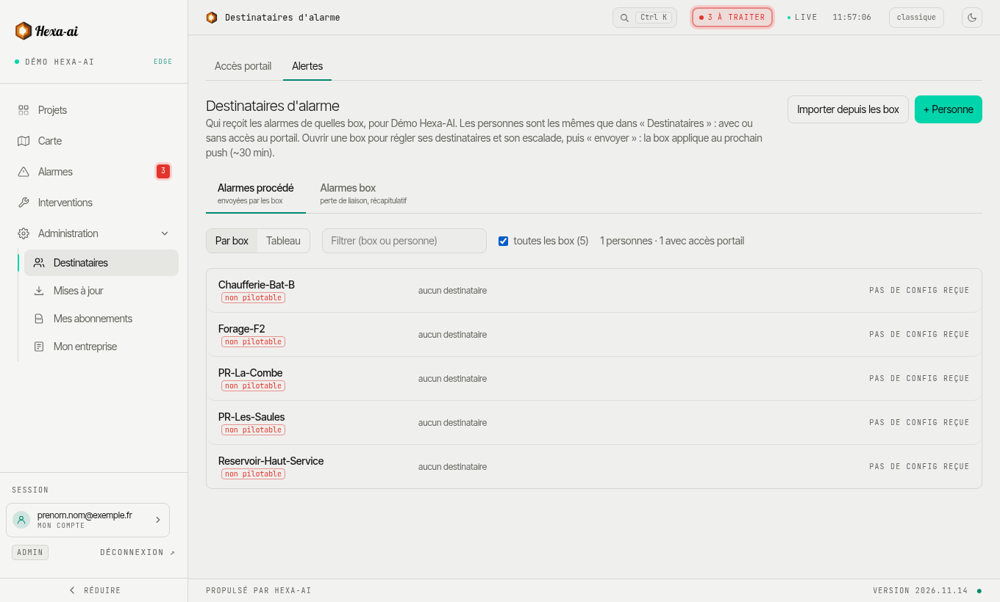

Ce sont **les box qui préviennent** les personnes en cas d'alarme. Le portail sert à régler, au même endroit pour tout le parc, **qui** chaque box prévient et **comment**. Il envoie ensuite ces réglages aux box.

:::note
Les administrateurs modifient l'ensemble de ces réglages. Un **gestionnaire** modifie les destinataires, l'escalade, l'envoi, la copie et la maintenance des box de son périmètre ; les autres utilisateurs consultent. Une box dont le logiciel ne permet pas ce réglage à distance est marquée **firmware non compatible**.
:::

La page s'ouvre par **Administration ▸ Destinataires ▸ onglet Alertes**, qui contient deux sous-onglets : **Alarmes procédé** (envoyées par les box, décrites ci-dessous) et **Alarmes box**.

## Alarmes box : perte de liaison et récapitulatif

Ces e-mails sont envoyés par le **portail**, pas par les box. Les réglages de l'entreprise (délai, qui reçoit, récapitulatif) sont réservés aux administrateurs. Les **abonnements** par box et la **Maintenance** sont aussi ouverts aux gestionnaires, sur les box de leur périmètre ; les autres rôles consultent.

- **Perte de liaison d'une box** : une box coupée ne peut pas prévenir elle-même. Le portail envoie un e-mail quand elle n'a plus donné de nouvelles depuis le **délai** choisi (**4 heures**, **24 heures** ou **7 jours**), puis un autre à son retour. Un seul e-mail par personne regroupe les box concernées. Choisissez **qui reçoit** (tous les administrateurs, tous les membres, ou personne) et mettez une box en **Maintenance** pour suspendre ses alertes, puis **Reprendre**.
- **Récapitulatif d'état** : un e-mail qui résume l'état des box (en ligne, hors ligne, alarmes actives), avec un lien vers le portail.
  - **Fréquence** : **jamais**, **tous les jours** ou **chaque semaine** ; pour un envoi hebdomadaire, choisissez le **jour** (mardi par défaut). Ce réglage vaut pour toute l'entreprise.
  - **Heure d'envoi** : le récapitulatif part tôt le matin, à heure fixe (vers 6 h, heure de Paris, en hiver ; vers 7 h en été). L'heure n'est pas réglable.
  - **Destinataires** : les personnes cochées dans la liste, à condition qu'elles aient un accès au portail. Chacune reçoit l'état des seules box qu'elle peut voir.
  - **Résumé par l'IA** : l'option **Ajouter un résumé rédigé par l'IA** transmet l'état des box à Google (Gemini) pour rédiger un court résumé en tête de l'e-mail.

Une personne sans accès au portail peut recevoir les e-mails de perte de liaison (astreinte, par exemple), mais pas le récapitulatif d'état.

## Les personnes

**+ Personne** ajoute quelqu'un à prévenir : nom, e-mail, téléphone. Une personne d'astreinte n'a pas forcément besoin d'un accès au portail :

- **Accès au portail : oui** : elle est invitée avec le rôle choisi (**Inviter au portail**, réservé aux administrateurs) ;
- **Accès au portail : non** : elle reçoit seulement les alarmes des box qui la préviennent.

Un gestionnaire peut ajouter, modifier et supprimer les personnes **sans** accès au portail. **Importer depuis les box** reprend les destinataires déjà configurés sur les box (réservé aux administrateurs).

## Affecter les personnes aux box

- Vue **Par box** : pour chaque box, la liste des personnes prévenues, leurs canaux (**mail**, **SMS**, **appel**) et les types d'alarme reçus (error, warning, info).
- Vue **Tableau** : toutes les box et toutes les personnes, pour un réglage en masse.
- **Copier les destinataires** d'une box vers d'autres box.

Un gestionnaire n'agit que sur les box de son périmètre : les autres box restent en consultation.

## Escalade

Pour une box, l'escalade prévient les personnes **par niveaux** : chaque niveau a son délai ; si l'alarme est toujours là une fois le délai écoulé, le niveau suivant est prévenu. Sans escalade (mode **immédiat**), toutes les personnes sont prévenues tout de suite. Le délai de chaque niveau va de 1 à 1 440 minutes, et des options permettent de cumuler les niveaux, d'arrêter quand l'alarme disparaît ou de prévenir à la clôture.

## Envoyer aux box

Les modifications ne prennent effet qu'une fois **envoyées** à la box. L'état de synchronisation de chaque box indique si elle a bien reçu ses destinataires.
