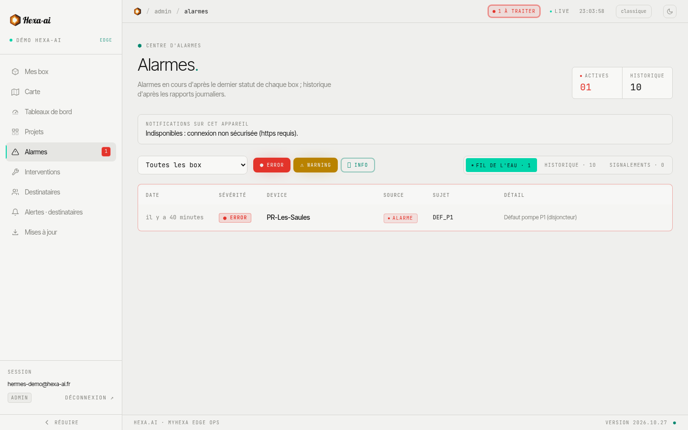

La page **Alarmes** regroupe les alarmes de toutes vos box.

## Trois vues

- **Fil de l'eau** : les alarmes **en cours**, d'après le dernier statut envoyé par chaque box.
- **Historique** : une ligne par occurrence (début, fin, durée, type, description), d'après les rapports journaliers des box. Les alarmes du jour y apparaissent **le lendemain** ; en attendant, elles sont dans le fil de l'eau.
- **Signalements** : les anomalies déclarées par les techniciens depuis la page d'intervention.

Les filtres **Toutes les box** et les sévérités (**Error**, **Warning**, **Info**) s'appliquent aux trois vues.

## Filtre actif

Par défaut, les éléments de sévérité **Info** sont masqués. Dès qu'une sévérité est masquée, son bouton apparaît **barré** et un bandeau **Filtre actif** indique combien d'éléments ne sont pas affichés. **Tout afficher** rétablit toutes les sévérités.

<video class="hai-clip" autoplay loop muted playsinline preload="metadata" poster="/portal/videos/filtre-poster.jpg" aria-label="Bandeau Filtre actif puis Tout afficher sur la page Alarmes"><source src="/portal/videos/filtre.webm" type="video/webm"><source src="/portal/videos/filtre.mp4" type="video/mp4"></video>

L'en-tête du portail affiche en permanence le nombre d'alarmes **à traiter**.

## Notifications

Le cadre **Notifications sur cet appareil** active une notification à chaque nouvelle alarme, même application fermée. Voir [Application sur téléphone](/portal/getting-started/mobile/).
