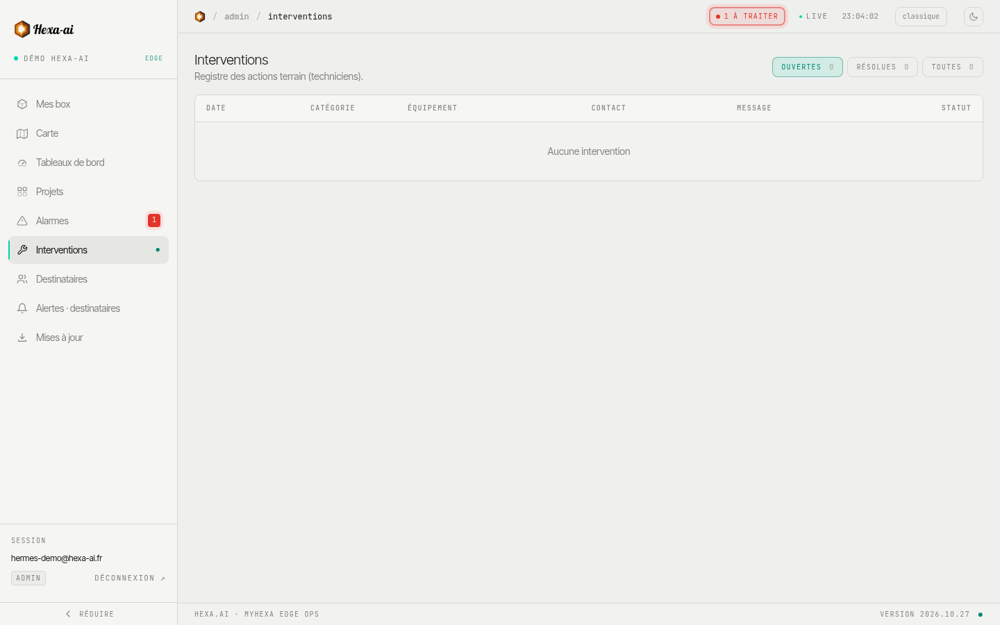

La page **Interventions** est le registre des actions de terrain. Les déclarations arrivent depuis la page publique de chaque box, ouverte par son QR code (voir [Fiche d'une box](/portal/fleet/device/#page-dintervention-et-qr-code)).

Pour chaque déclaration : date, catégorie (**Intervention**, **Incident**, **Contrôle**, **Autre**), box concernée, technicien et ses coordonnées, message, photos et statut.

- Filtres **Ouvertes**, **Résolues**, **Toutes**.
- Cliquez sur une ligne pour le détail et les photos.
- **Marquer résolue** clôt la déclaration ; **Rouvrir** la remet en cours.

Le nombre d'interventions ouvertes apparaît dans l'en-tête du portail.
