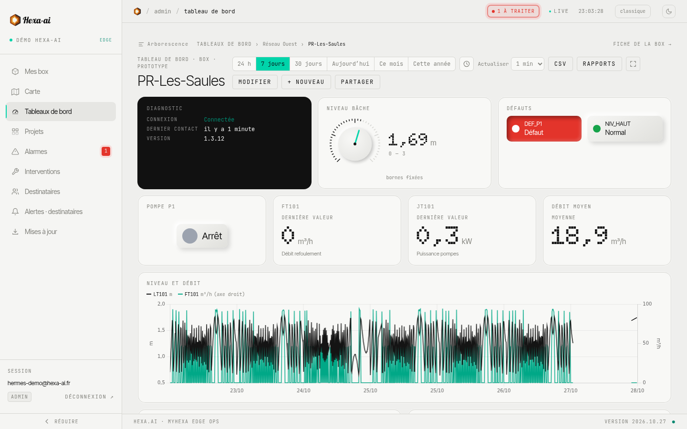
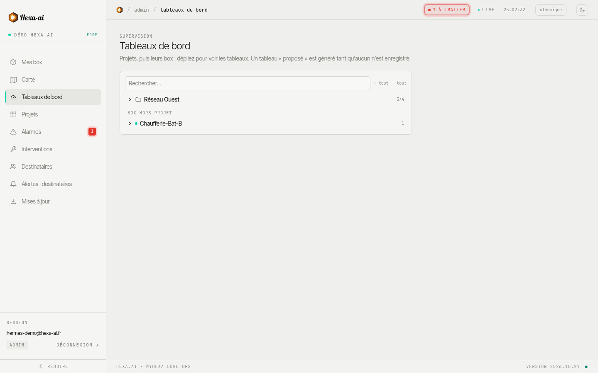
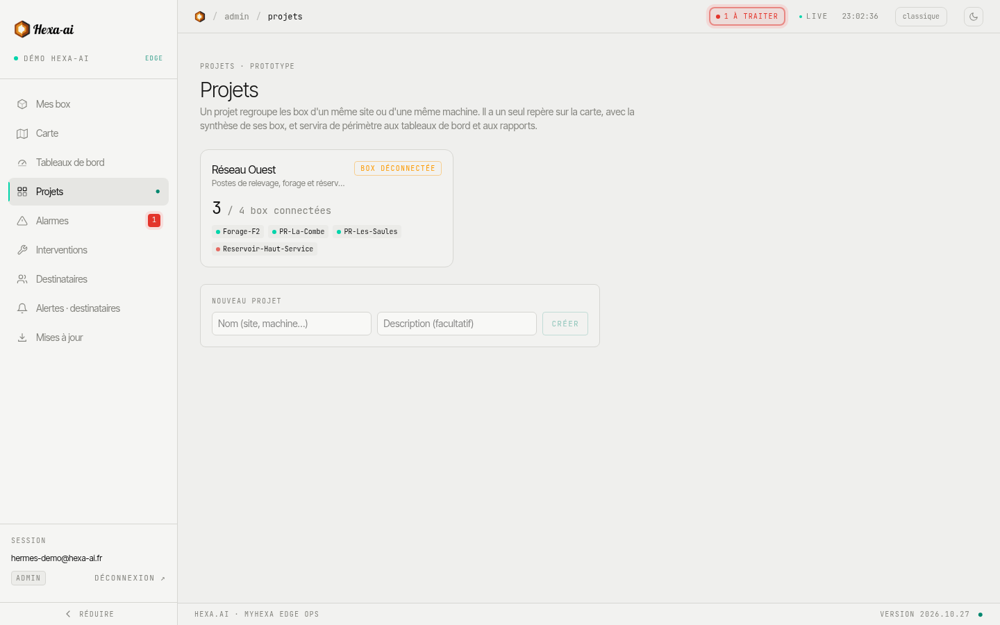
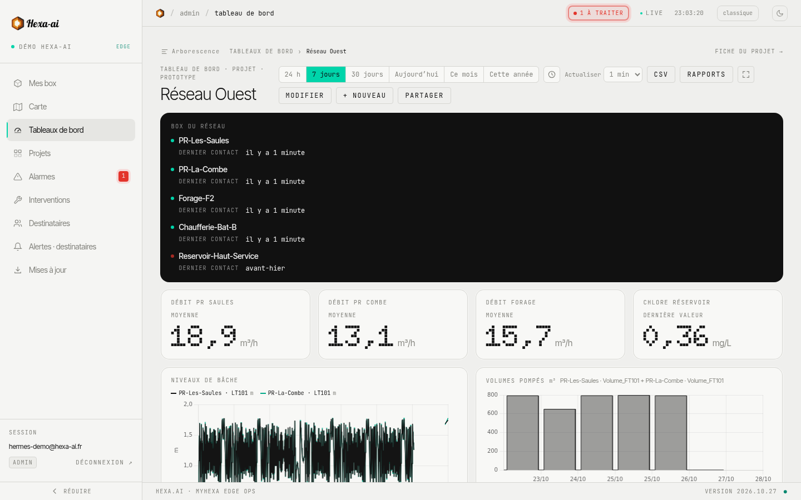
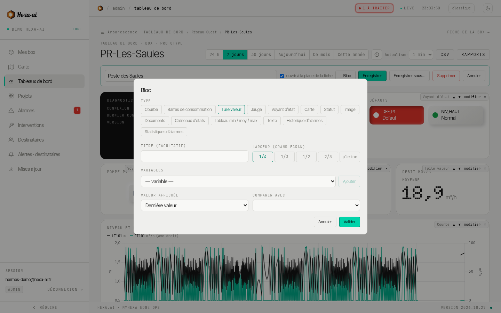
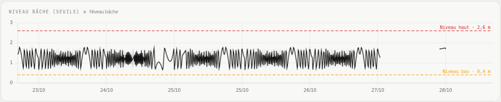

Un tableau de bord présente sur une page les informations utiles d'une installation : valeurs, courbes, jauges, alarmes, documents.

## Box ou projet

Un tableau est rattaché :

- à **une box** : ses propres variables ;
- à **un projet** : un groupe de box (un réseau, un site), pour comparer ou cumuler.

La page **Tableaux de bord** les liste par box et par projet.

### Les projets

La page **Projets** crée les regroupements de box : un nom, une description, puis les box qui en font partie. Une box appartient à un seul projet, ou à aucun.

## Période et rafraîchissement

En haut du tableau, choisissez la période : **24 h**, **7 jours**, **30 jours**, **Aujourd'hui**, **Ce mois**, ou une plage personnalisée. Le menu de rafraîchissement met les valeurs à jour automatiquement (de 30 s à 5 min, ou **Arrêt**).

Le bouton **CSV** exporte les données du tableau sur la période affichée, au choix en version **Détaillée** (pas de 5 min, volumes par heure) ou **Comme affiché** (plus léger). Un export détaillé sur une longue période peut prendre quelques minutes.

## Composer un tableau

Les administrateurs composent les tableaux ; les autres utilisateurs les consultent. **Modifier** passe en édition : ajoutez des blocs, réordonnez-les par glisser-déposer, puis **Enregistrer** (ou **Enregistrer sous…** pour en faire un nouveau tableau).

Blocs disponibles :

| Bloc | Usage |
|---|---|
| **Courbe** | Évolution d'une ou plusieurs variables, avec comparaison possible à la période précédente et [seuils](#seuils-sur-les-courbes) |
| **Barres de consommation** | Compteurs (volumes, énergie) en barres, par intervalle |
| **Tuile valeur** | Une valeur courante en grand |
| **Jauge** | Une valeur entre un minimum et un maximum |
| **Voyant d'état** | Marche / arrêt, défaut, avec couleurs |
| **Créneaux d'états** | Périodes de marche et d'arrêt dans le temps |
| **Tableau min / moy / max** | Synthèse chiffrée de plusieurs variables |
| **Statut** | Connexion et version de la box |
| **Carte** | Localisation |
| **Historique d'alarmes** / **Statistiques d'alarmes** | Alarmes de la période |
| **Documents** | Liens vers des documents de la box |
| **Signalements** | Le dernier signalement de terrain en grand, avec ses photos (voir [plus bas](#bloc-signalements)) |
| **Image** / **Texte** | Schéma, photo, consignes |

Les réglages de chaque bloc (titre, variables, période de comparaison, largeur sur grand écran…) s'ouvrent depuis le bloc en mode édition.

## Seuils sur les courbes

Sur un bloc **Courbe** ou **Barres**, ajoutez des **seuils** : un trait horizontal en pointillés, avec sa description et sa valeur, par exemple *Niveau haut · 2,6 m*. Pratique pour voir d'un coup d'œil si une mesure approche d'une limite.

<video class="hai-clip" autoplay loop muted playsinline preload="metadata" poster="/portal/videos/seuils-poster.jpg" aria-label="Ajout d'un seuil sur une courbe d'un tableau de bord"><source src="/portal/videos/seuils.webm" type="video/webm"><source src="/portal/videos/seuils.mp4" type="video/mp4"></video>

Dans les réglages du bloc, section **Seuils** :

1. **+ Ajouter un seuil** ;
2. saisissez la **valeur** et une **description** (facultative) ;
3. choisissez une couleur (rouge, orange, bleu, vert ou gris) ;
4. validez, puis **Enregistrer** le tableau.

Les seuils se lisent sur l'axe de gauche. L'échelle s'élargit si besoin pour qu'un seuil reste toujours visible, même quand les valeurs de la période en sont loin. Ils apparaissent aussi dans les [rapports PDF](/portal/dashboards/reports/).

## Bloc Signalements

Le bloc **Signalements** met en avant ce que les techniciens ont déclaré sur le terrain (voir [Interventions](/portal/alarms/interventions/)) :

- le **dernier signalement en grand** : box, gravité, catégorie, auteur, description et **galerie de photos** ; un clic sur une photo l'agrandit ;
- en dessous, les **précédents** ; un clic en affiche un en grand.

<video class="hai-clip" autoplay loop muted playsinline preload="metadata" poster="/portal/videos/signalements-poster.jpg" aria-label="Bloc Signalements : galerie de photos et signalements précédents"><source src="/portal/videos/signalements.webm" type="video/webm"><source src="/portal/videos/signalements.mp4" type="video/mp4"></video>

Réglages : les **box** concernées, quoi **afficher** (signalements, interventions, photos), **lesquels** (les ouverts, ou ceux de la période du tableau) et le **nombre affiché**. Le bloc se met à jour avec le rafraîchissement du tableau : sur un écran mural, un nouveau signalement apparaît tout seul.
