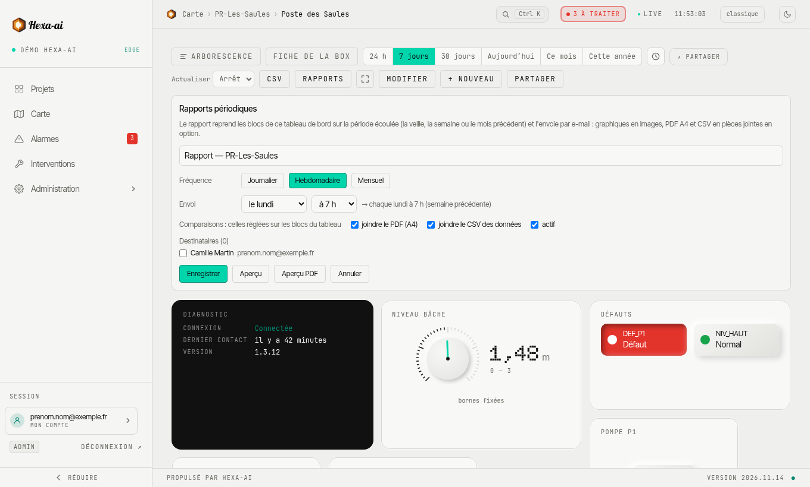

Un rapport envoie automatiquement par e-mail le contenu d'un tableau de bord, chaque jour, chaque semaine ou chaque mois.

## Créer un rapport

1. Ouvrez le tableau de bord, puis **Rapports**.
2. **+ Rapport** (pour les administrateurs, et pour les gestionnaires sur les tableaux de leur périmètre ; les lecteurs et opérateurs consultent les rapports sans les modifier), et donnez-lui un nom.
3. Choisissez la **fréquence** (**Journalier**, **Hebdomadaire**, **Mensuel**), le jour (un jour de la semaine, ou du 1er au 28 du mois) et l'heure d'envoi.
4. Cochez les pièces jointes : **PDF** (format A4) et/ou **CSV des données**.
5. Sélectionnez les **destinataires** parmi les personnes de votre entreprise (seules celles qui ont une adresse e-mail sont proposables ; la liste est la même pour un gestionnaire et pour un administrateur).
6. **Enregistrer**.

Le rapport couvre la période écoulée : la veille pour un rapport journalier, la semaine ou le mois précédent sinon. Les comparaisons sont celles réglées sur les blocs du tableau.

## Vérifier avant d'envoyer

- **Aperçu PDF** (dans l'éditeur du rapport) : télécharge le document tel qu'il sera envoyé.
- **Aperçu** : le mail, en version **Ordinateur** ou **Téléphone**.
- **Envoyer maintenant** : un envoi immédiat, hors calendrier.

## Logo et suivi

- **Logo des rapports** : l'administrateur ajoute le logo de l'entreprise (PNG ou JPEG, 2 Mo maximum). Il est commun à toute l'entreprise et figure en tête des mails et des PDF ; c'est un réglage d'entreprise, que le gestionnaire ne modifie pas.
- **Derniers rapports générés** (les 30 derniers) : période couverte, état (envoyé, archivé non envoyé, erreur), destinataires, et accès au PDF et au CSV de chaque envoi.

Un rapport peut être désactivé sans être supprimé (case **actif** décochée) ; le tableau de bord d'un projet fermé est en consultation seule : ses rapports ne se modifient plus.

## Qui peut gérer les rapports

Un rapport se gère comme le tableau de bord auquel il est attaché : **créer, modifier, activer ou désactiver, supprimer** et **Envoyer maintenant** sont ouverts à l'administrateur et au **gestionnaire dont le périmètre couvre la box ou le projet du tableau**. Hors de son périmètre, un gestionnaire ne voit pas ces rapports ; le lecteur et l'opérateur voient les rapports et leur historique, et peuvent en faire un **Aperçu**, sans pouvoir les modifier.
