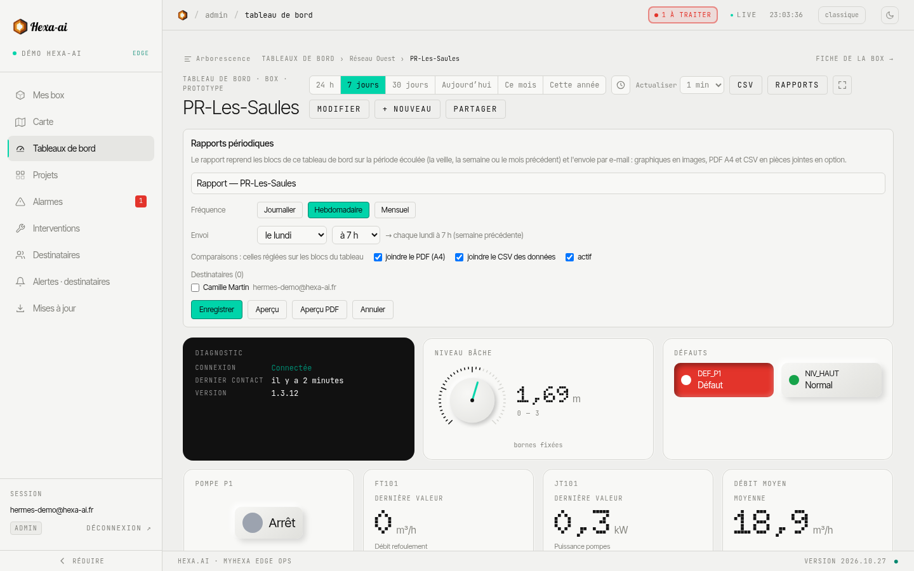

Un rapport envoie automatiquement par e-mail le contenu d'un tableau de bord, chaque jour, chaque semaine ou chaque mois.

## Créer un rapport

1. Ouvrez le tableau de bord, puis **Rapports**.
2. **+ Rapport** (réservé aux administrateurs), et donnez-lui un nom.
3. Choisissez la **fréquence** (**Journalier**, **Hebdomadaire**, **Mensuel**), le jour et l'heure d'envoi.
4. Cochez les pièces jointes : **PDF** (format A4) et/ou **CSV des données**.
5. Sélectionnez les **destinataires** parmi les personnes de votre entreprise.
6. **Enregistrer**.

Le rapport couvre la période écoulée : la veille pour un rapport journalier, la semaine ou le mois précédent sinon. Les comparaisons sont celles réglées sur les blocs du tableau.

## Vérifier avant d'envoyer

- **Aperçu PDF** : le document tel qu'il sera envoyé.
- **Aperçu** : le mail, en version ordinateur et téléphone.
- **Envoyer maintenant** : un envoi immédiat, hors calendrier.

## Logo et suivi

- **Logo des rapports** : ajoutez le logo de votre entreprise (PNG ou JPEG, 2 Mo maximum). Il est commun à toute l'entreprise et figure en tête des mails et des PDF.
- **Derniers rapports générés** : période couverte, destinataires, et accès au PDF et au CSV de chaque envoi.

Un rapport peut être désactivé sans être supprimé.
