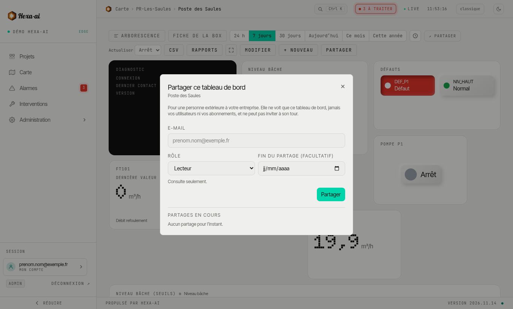

Vous pouvez montrer un tableau de bord à un partenaire, un client final ou un bureau d'études, **sans lui ouvrir le reste de votre compte**.

## Partager

1. Ouvrez le tableau, puis **↗ Partager** (en haut du tableau).
2. Saisissez l'**e-mail** de la personne, éventuellement une **fin du partage**.
3. Validez : si la personne n'a pas encore de compte myHexa, elle reçoit une invitation par e-mail (« Invitation envoyée à… ») ; sinon le tableau apparaît dans son portail, rubrique **Partagés avec moi**.

La liste **Partages en cours** permet de **Retirer** l'accès à tout moment. Pour un tableau, le rôle proposé est **Lecteur** : la personne consulte le tableau en lecture seule, sans le modifier ni le repartager.

## Ce que voit la personne invitée

- Le tableau, **en lecture seule** : elle ne peut ni le modifier ni le repartager.
- Uniquement les données des blocs du tableau : pas la fiche de la box, ni l'historique complet, ni vos autres box.
- Uniquement les documents placés dans un bloc **Documents** du tableau.

Le partage est réservé aux administrateurs de l'entreprise propriétaire. Le mécanisme est le même pour un projet, une box ou un synoptique, avec d'autres rôles possibles : voir [Partager avec une personne extérieure](/portal/administration/external-sharing/).
