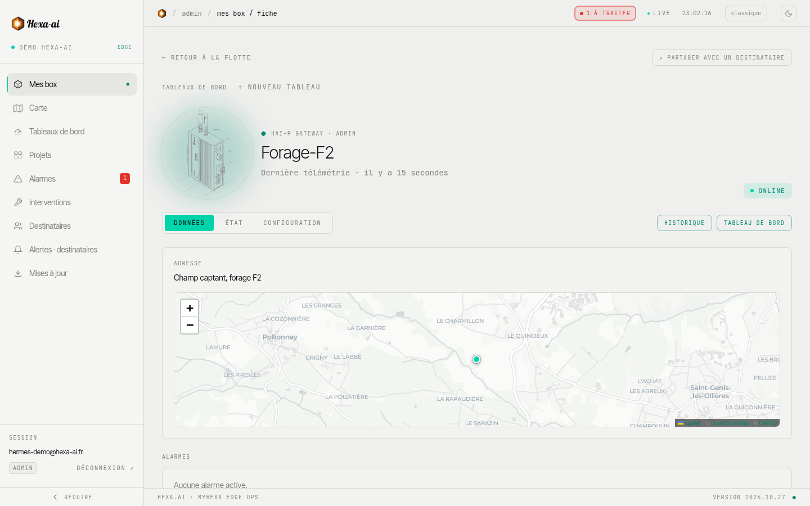

La fiche rassemble tout ce qui concerne une box.

## En-tête

Le nom de la box, son modèle, l'heure de la **dernière télémétrie** et son état (**en ligne** / **hors ligne**). Deux boutons mènent à son [historique](/portal/fleet/history/) et à son [tableau de bord](/portal/dashboards/dashboards/).

## Les onglets

- **Données** : adresse et carte, alarmes actives, puis les valeurs courantes classées en **Mesures**, **Compteurs** et **États**.
- **État** : version du logiciel, temps de fonctionnement, fuseau horaire, interfaces réseau (Ethernet, Wi-Fi, 4G) et services.
- **Configuration** : adresse de la box et son **QR code d'intervention terrain**. Les modifications sont réservées aux administrateurs.

## Documents

Rattachez à la box ses documents utiles : **plan électrique**, **analyse fonctionnelle**, **manuel / notice**, **photo de l'installation**, ou autre.

1. Section **Documents**, bouton **+ Ajouter**.
2. Choisissez le fichier, son type et, si besoin, une description.
3. Cochez **Accessible via QR code** pour le rendre visible sur la page d'intervention (sans connexion).

Un document peut passer de **public** à **privé** à tout moment.

## Page d'intervention et QR code

Chaque box dispose d'une page publique, ouverte en scannant son QR code, **sans compte myHexa**. Le QR code s'obtient dans l'onglet **Configuration** de la fiche : imprimez-le et collez-le sur l'armoire. Un technicien sur site peut :

- consulter les documents marqués publics ;
- déclarer une **intervention** ou signaler une **anomalie** : nom, e-mail ou téléphone, gravité, catégorie, commentaire et jusqu'à **5 photos** (compressées sur le téléphone avant l'envoi).

Les déclarations arrivent dans [Interventions](/portal/alarms/interventions/).

## Partager la box avec une personne

**Partager avec un destinataire** donne accès à cette box à une personne, par son adresse e-mail. La liste **Partages actifs** permet de retirer un accès.
