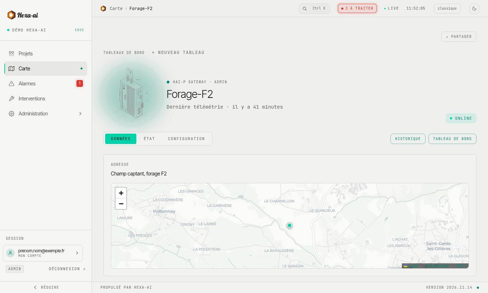
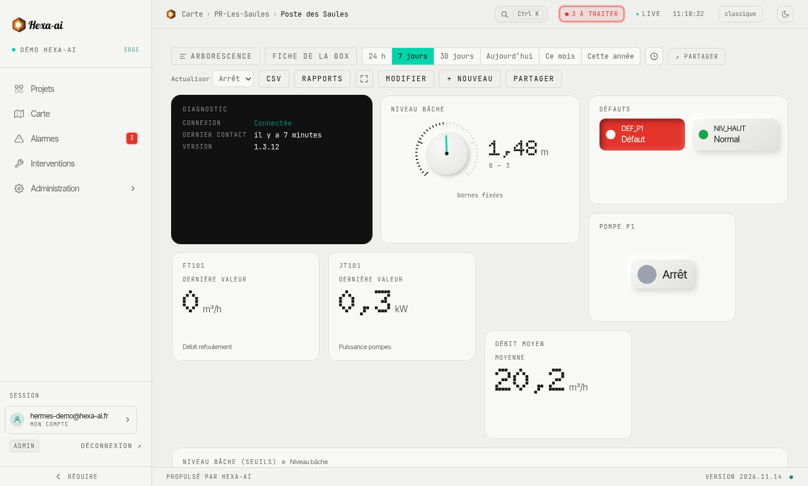

La fiche rassemble tout ce qui concerne une box.

## En-tête

Quand vous ouvrez une box (depuis la carte, un projet ou **Ctrl K**), c'est son **tableau de bord par défaut** qui s'affiche (voir [Tableaux de bord](/portal/dashboards/dashboards/)), avec la période, le mode **Direct**, **CSV**, **Rapports**, **Partager** et le bouton **Fiche de la box**. La fiche montre le nom de la box, son modèle, l'heure de la **dernière télémétrie** et son état (**en ligne** / **hors ligne**) ; l'[historique](/portal/fleet/history/) de ses variables s'ouvre depuis la fiche.

## Les onglets

- **Données** : adresse et carte, alarmes actives, puis les valeurs courantes classées en **Mesures**, **Compteurs** et **États**.
- **État** : version du logiciel, temps de fonctionnement, fuseau horaire (**Timezone**), interfaces réseau (Ethernet, Wi-Fi, 4G) et services.
- **Configuration** : adresse de la box, son **QR code d'intervention terrain** et, selon la box, l'accès à distance à l'écran de l'automate (VNC). Les modifications sont réservées aux administrateurs.

## Documents

La fiche affiche aussi les **documents du projet** de la box (voir [Documents](/portal/projects/documents/)). Rattachez à la box ses documents utiles : **plan électrique**, **analyse fonctionnelle**, **manuel / notice**, **photo installation**, ou autre. L'ajout et la modification sont réservés aux administrateurs.

1. Section **Documents**, bouton **+ Ajouter**.
2. Choisissez le fichier, son type et, si besoin, une description.
3. Cochez **Accessible via QR code** pour le rendre visible sur la page d'intervention (sans connexion).

Un document peut passer de public à privé (et inversement) à tout moment, avec les boutons **→ Privé** et **→ Public**.

## Page d'intervention et QR code

Chaque box dispose d'une page publique, ouverte en scannant son QR code, **sans compte myHexa**. Le QR code s'obtient dans l'onglet **Configuration** de la fiche : imprimez-le et collez-le sur l'armoire. Un technicien sur site peut :

- consulter les documents marqués publics ;
- déclarer une **intervention** ou signaler une **anomalie** : nom, e-mail ou téléphone, gravité, catégorie, commentaire et jusqu'à **5 photos** (compressées sur le téléphone avant l'envoi).

Les déclarations arrivent dans [Interventions](/portal/alarms/interventions/).

## Partager la box avec une personne

Le bouton **↗ Partager** donne accès à cette box seule à une personne extérieure à l'entreprise, avec le rôle **Lecteur** ou **Opérateur** et une date de fin facultative. Voir [Partager avec une personne extérieure](/portal/administration/external-sharing/). Pour donner accès à plusieurs box à un collègue, utilisez plutôt les [rôles et périmètres](/portal/administration/roles/).
