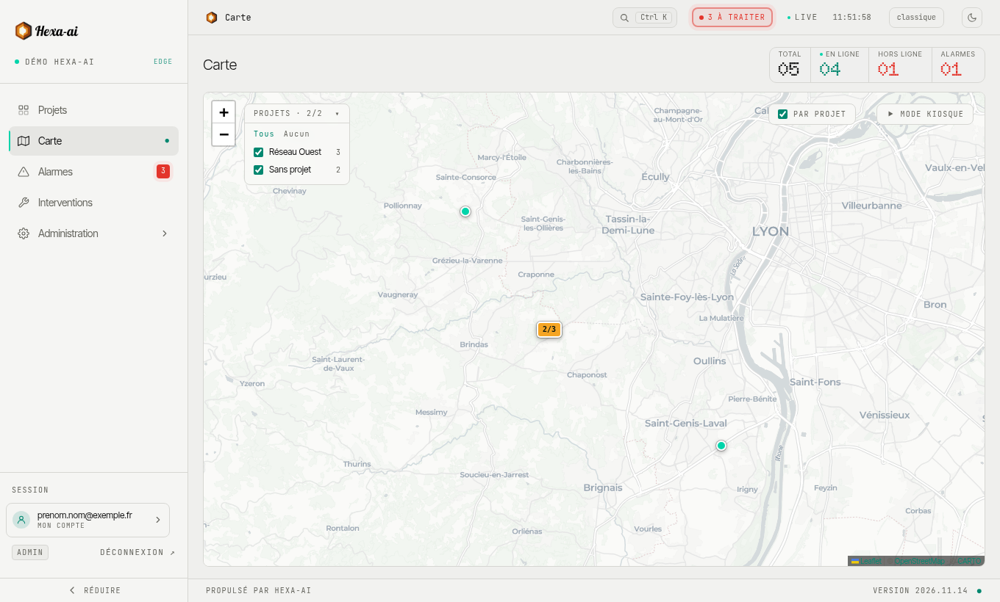

## La carte

La page **Carte** place vos box sur une carte, à partir de l'adresse ou des coordonnées renseignées. En haut à droite, quatre compteurs résument le parc : **Total**, **En ligne**, **Hors ligne** et **Alarmes**.

- Les box d'un même [projet](/portal/projects/projects/) partagent un seul repère, avec la synthèse de leurs box ; la case **Par projet** active ou désactive ce regroupement. Les box sans projet ont chacune le leur.
- Le panneau **Projets** liste vos projets : décochez-en pour les masquer, **Tous** / **Aucun** pour tout cocher ou décocher.
- Un repère en alarme est signalé ; cliquez sur un repère pour la synthèse, puis sur une box pour ouvrir sa page.
- **Mode kiosque** passe les repères en revue automatiquement, toutes les 12 secondes, par exemple pour un écran de supervision.

La carte est la page d'accueil d'une personne qui ne voit aucun projet ; sinon, c'est la page **Projets**.

## La liste des box

Il n'y a plus de page « Mes box » : la liste de vos box se trouve dans l'onglet **Équipements** de chaque projet (et de l'espace [Général](/portal/projects/projects/#lespace-général) pour les box sans projet), en liste ou sur une carte. Pour chaque box : **État** (en ligne si elle a donné des nouvelles dans l'heure), **Nom**, **Alarmes**, **Réseau**, **Accès** et **Dernier contact**. Les anciennes adresses « Mes box » redirigent vers la carte.

Cliquez sur une box pour ouvrir sa [page](/portal/fleet/device/). Vous pouvez aussi la retrouver avec **Ctrl K** ([Se repérer dans le portail](/portal/getting-started/navigation/)).
