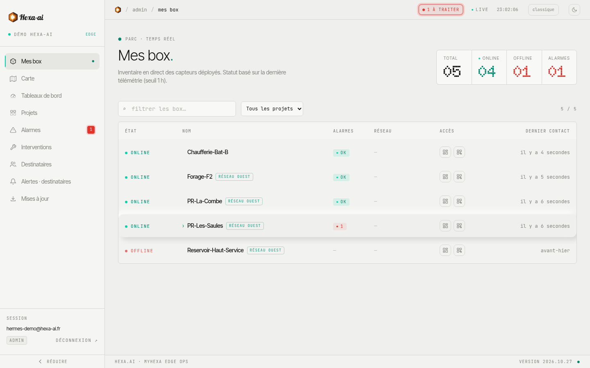
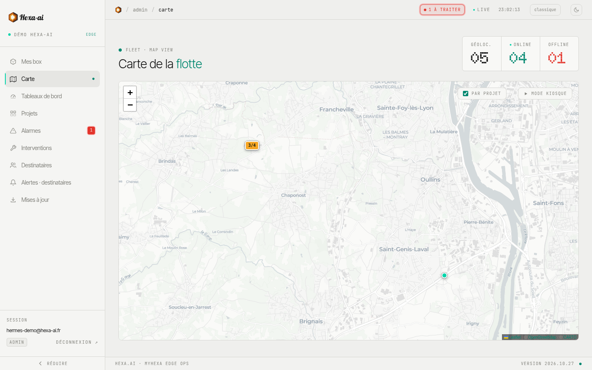

## La liste des box

La page **Mes box** est l'accueil du portail. Elle liste toutes les box auxquelles vous avez accès.

En haut, quatre compteurs résument le parc : **Total**, **En ligne**, **Hors ligne** et **Alarmes**.

Pour chaque box :

- **Statut** : **en ligne** si la box a donné des nouvelles dans l'heure, sinon **hors ligne** ;
- **Nom** et **projets** auxquels elle appartient ;
- **Alarmes** actives ;
- **Dernier contact**.

Le champ de recherche et le filtre **Tous les projets** réduisent la liste. Cliquez sur une box pour ouvrir sa [fiche](/portal/fleet/device/).

## La carte

La page **Carte** place les box sur une carte, à partir de l'adresse ou des coordonnées renseignées.

