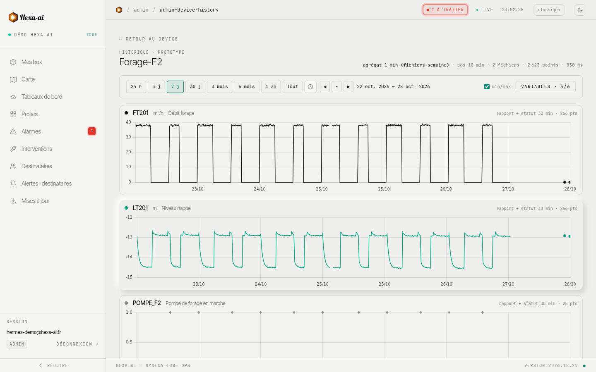

L'historique affiche l'évolution des variables d'une box sur la période de votre choix. On y accède par le bouton **Historique** de la fiche.

## Choisir quoi afficher

- **Variables** : cochez celles à afficher (recherche par nom, **tout cocher**, **aucune**). Chaque variable a son propre graphique, avec son unité.
- **Période** : boutons de durée en haut de page, ou **Tout** pour l'ensemble de l'historique.
- **Navigation** : **◀** et **▶** pour reculer et avancer, **−** pour dézoomer.
- **min/max** : case cochée par défaut ; affiche l'enveloppe minimum-maximum en plus de la moyenne, pour ne pas manquer un pic.

## Zoomer

Sur un graphique, cliquez-glissez sur la zone qui vous intéresse : la période se resserre dessus. Le survol affiche la date et la valeur exactes.

<video class="hai-clip" autoplay loop muted playsinline preload="metadata" poster="/portal/videos/historique-poster.jpg" aria-label="Zoom à la souris sur une courbe de l'historique"><source src="/portal/videos/historique.webm" type="video/webm"><source src="/portal/videos/historique.mp4" type="video/mp4"></video>

## Longues périodes : ce que vous voyez

Sur plusieurs semaines, une box a enregistré bien plus de valeurs que l'écran ne peut en afficher. Le portail découpe alors la période en **cases de temps** (au plus 1 500 par variable) et garde pour chacune la **moyenne**, le **minimum** et le **maximum**. La courbe trace la moyenne ; l'option **min/max** affiche l'enveloppe, si bien qu'un pic bref reste visible. Les compteurs (volumes, énergie) sont, eux, totalisés par heure, par jour ou par semaine selon la durée affichée.

Resserrez la période (ou zoomez) pour retrouver le détail point par point.

## Bon à savoir

- L'historique dépend de ce que la box enregistre : seules les variables historisées sur la box y figurent.
- Les données arrivent par lots : les dernières minutes peuvent ne pas encore y être. La valeur en direct reste visible sur la fiche.
