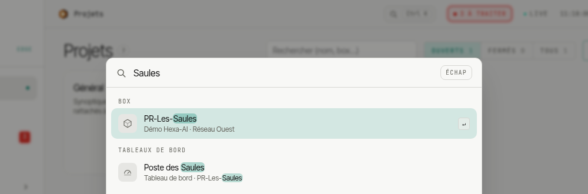
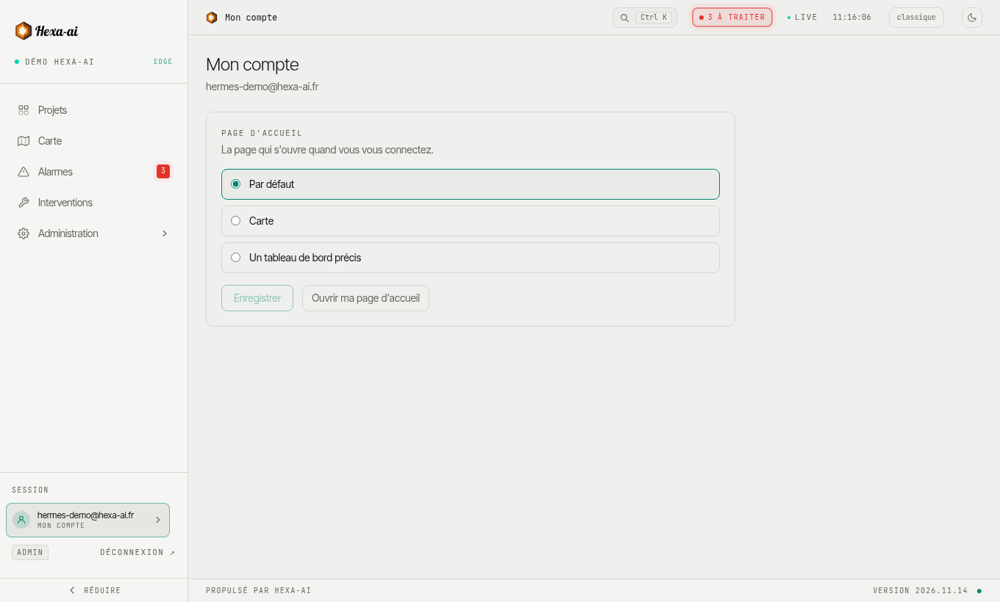

## Le menu

Le menu de gauche donne accès aux pages du portail. Ce que vous y voyez dépend de votre [rôle](/portal/administration/roles/) et de ce que vous suivez :

| Entrée | Pour quoi faire |
|---|---|
| **Projets** | Les projets, leurs tableaux de bord, synoptiques, documents. Voir [Projets](/portal/projects/projects/). |
| **Carte** | Toutes vos box sur une carte. Voir [Carte et box](/portal/fleet/fleet/). |
| **Alarmes** | Les alarmes de toutes vos box. Une pastille rouge donne le nombre d'alarmes à traiter. Voir [Alarmes](/portal/alarms/alarms/). |
| **Interventions** | Le registre des déclarations de terrain. Voir [Interventions](/portal/alarms/interventions/). |
| **Administration** | **Destinataires**, **Mises à jour**, **Mes abonnements**, **Mon entreprise** (selon vos droits). |

Si votre entreprise n'a encore aucune box (par exemple un client qui suit un [projet d'intégration](/portal/projects/integration/)), le menu se réduit à **Projets**. Les anciennes adresses « Mes box » et « Tableaux de bord » redirigent vers **Carte** et **Projets** : vos favoris restent valables.

En bas du menu, **Mon compte** ouvre vos réglages, **Déconnexion** ferme la session et **Réduire** replie le menu. Le bouton en forme de lune, en haut à droite, passe du thème clair au thème sombre. L'en-tête affiche aussi le nombre d'alarmes **à traiter**, l'indicateur **Live** et l'heure.

## Recherche rapide : Spotlight

Appuyez sur **Ctrl K** (**⌘ K** sur Mac), ou cliquez sur le champ **Ctrl K** de l'en-tête, depuis n'importe quelle page. Tapez quelques lettres : le Spotlight cherche dans vos pages, vos box, vos tableaux de bord, vos synoptiques, vos projets, vos documents et vos variables.

<video class="hai-clip" autoplay loop muted playsinline preload="metadata" poster="/portal/videos/spotlight-poster.jpg" aria-label="Ctrl K ouvre le Spotlight, on tape Saules, on choisit la box, la page de la box s'ouvre"><source src="/portal/videos/spotlight.webm" type="video/webm"><source src="/portal/videos/spotlight.mp4" type="video/mp4"></video>

- Sans saisie, il propose d'abord ce qui concerne la page où vous êtes (groupe **Ici**), puis vos **Récents**.
- **↑ ↓** pour naviguer, **↵** pour ouvrir, **Ctrl ↵** pour ouvrir dans un nouvel onglet, **Échap** pour fermer.
- Il ne propose que ce que vous avez le droit de voir : jamais une page absente de votre menu.

## Mon compte et page d'accueil

**Mon compte** (en bas du menu) permet de choisir la **page d'accueil** : celle qui s'ouvre quand vous vous connectez.

- **Par défaut** : la page **Projets** (la **Carte** si vous ne voyez aucun projet) ; un client sans box qui suit un seul projet d'intégration arrive directement dessus ;
- **Carte** ;
- **Un tableau de bord précis** : à choisir dans la liste, utile pour un écran de supervision.

**Enregistrer** valide votre choix, **Ouvrir ma page d'accueil** l'affiche tout de suite. Si le tableau choisi disparaît ou n'est plus accessible, vous arrivez sur la page par défaut. Un administrateur peut aussi régler la page d'accueil d'un autre utilisateur ([Utilisateurs et accès](/portal/administration/users/)).
