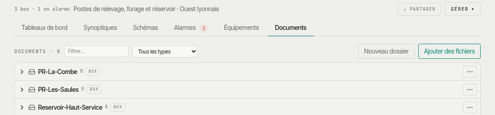

L'onglet **Documents** d'un projet est un explorateur : un dossier par box du projet, plus vos propres dossiers et fichiers (plans, notices, analyses, photos, rapports…).

## Parcourir

- Le champ **Filtrer…** et la liste **Tous les types** réduisent l'affichage.
- Chaque box du projet a son dossier (repéré par **BOX**), qui contient les documents rattachés à cette box.
- Un clic sur un fichier l'ouvre dans la visionneuse, avec **Télécharger** et **Nouvel onglet**. Le menu **⋯** de chaque ligne propose les autres actions, selon vos droits.

## Ajouter

- **Ajouter des fichiers** : choisissez les fichiers sur votre ordinateur.
- **Nouveau dossier** : créez l'arborescence qui vous convient (le dossier d'une box ne contient pas de sous-dossier : une box se range seule).
- Vous pouvez aussi **glisser des fichiers sur un dossier** pour les y déposer.

À l'ajout, indiquez le **Titre**, le **Type** et la **Visibilité** ; la case **Public** rend le document consultable sans connexion depuis la page d'intervention de la box (QR code). L'ajout, le déplacement et la suppression demandent le rôle **Gestionnaire** ou **Administrateur** ([Rôles et périmètres](/portal/administration/roles/)) ; un **Lecteur** ou un **Opérateur** consulte et télécharge.

## Retrouver un document

Le [Spotlight](/portal/getting-started/navigation/#recherche-rapide--spotlight) (**Ctrl K**) cherche aussi dans le titre des documents de tous vos projets.

## Documents d'une box

Les documents peuvent aussi être rattachés à une box, depuis sa fiche (onglet **Données**), et rendus accessibles par QR code aux techniciens sur site : voir [Fiche d'une box](/portal/fleet/device/).
