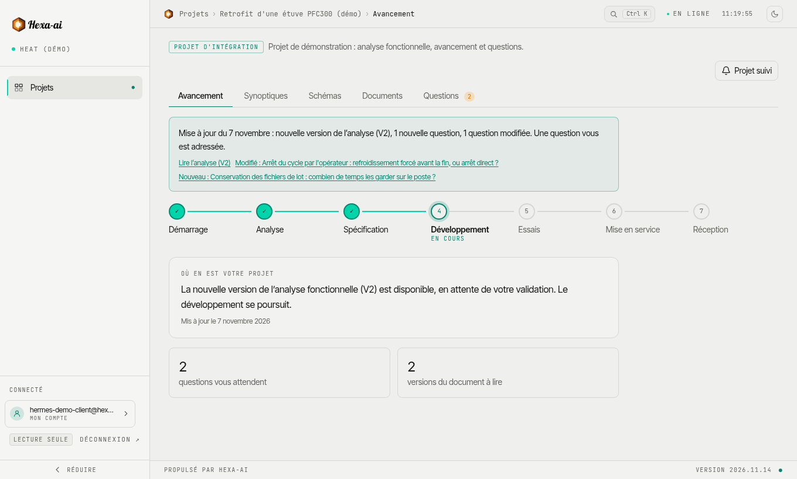
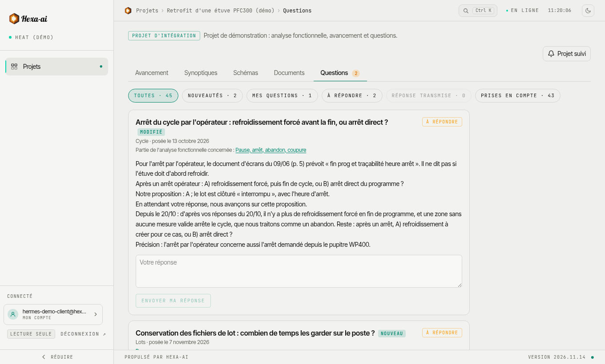

Quand Hexa-AI réalise votre installation, votre projet porte l'étiquette **Projet d'intégration**. Vous y suivez la réalisation sans échanger de fichiers par e-mail. Ces projets sont créés par Hexa-AI ; ils ne sont visibles que par les personnes que vous avez choisies avec nous.

:::note
Votre vue est en **lecture seule**, sauf pour répondre aux questions et les commenter. Si vous n'avez pas de box, le menu se réduit à **Projets** ; avec un seul projet, la connexion vous y amène directement.
:::

## Avancement

L'onglet **Avancement** montre où en est votre projet sur sept étapes : **Démarrage**, **Analyse**, **Spécification**, **Développement**, **Essais**, **Mise en service**, **Réception**. Le cadre **Où en est votre projet** résume la situation en une phrase, avec sa date de mise à jour. Un encart de **nouveautés** signale ce qui a changé (nouvelle version du document, nouvelle question, question modifiée), avec des liens directs, et deux compteurs indiquent les **questions qui vous attendent** et les **versions du document à lire**.

## Répondre aux questions

Quand l'équipe a besoin d'une précision, elle pose une question dans l'onglet **Questions** (un compteur signale celles qui vous attendent). Filtrez par **Toutes**, **Nouveautés**, **Mes questions**, **À répondre**, **Réponse transmise** ou **Prises en compte**.

1. Ouvrez la question : le texte, la partie de l'analyse fonctionnelle concernée et les propositions sont affichés.
2. Écrivez dans **Votre réponse**, puis **Envoyer ma réponse**.

Votre réponse nous parvient et la question passe en **Réponse transmise**. Elle **reste ouverte** tant qu'Hexa-AI ne l'a pas prise en compte : vous pouvez ajouter une précision à tout moment.

## Documents

L'onglet **Documents** a deux vues : **Fichiers** (les documents du projet) et **Analyse fonctionnelle** (le texte de l'analyse, publié par sections). Les onglets **Synoptiques** et **Schémas** montrent ce qu'Hexa-AI y a publié.

## Suivre le projet par e-mail

Le bouton **Projet suivi** (en haut à droite de la page) vous abonne aux nouveautés : vous recevez au plus **un e-mail récapitulatif par jour**. Une question qui vous est adressée vous parvient toujours, suivi ou non. Cliquez de nouveau pour arrêter. Un administrateur peut aussi régler le suivi de chaque personne dans **Administration ▸ Destinataires**.
