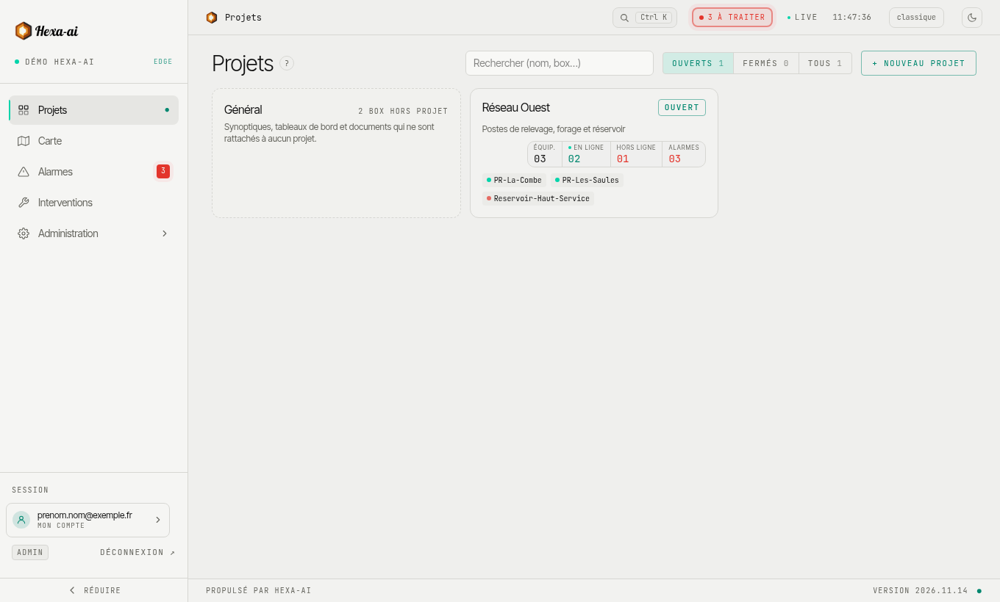
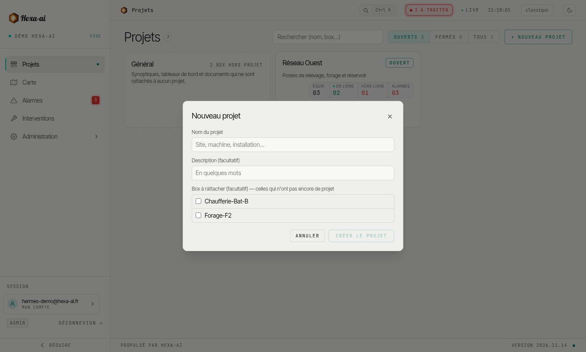
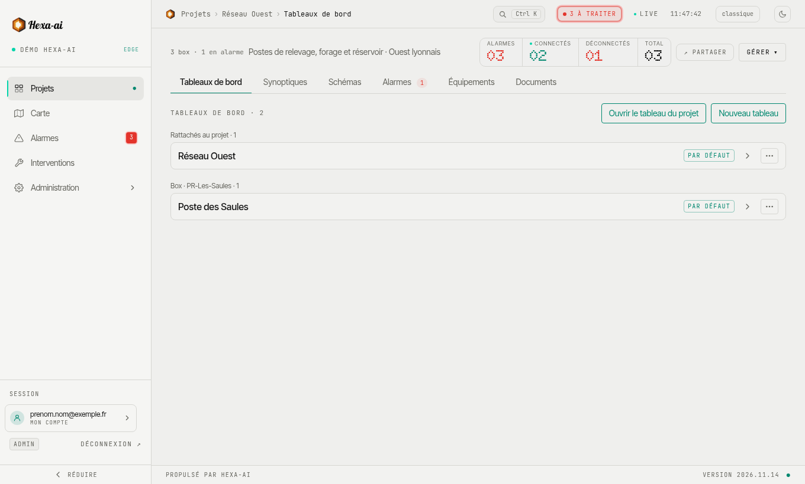
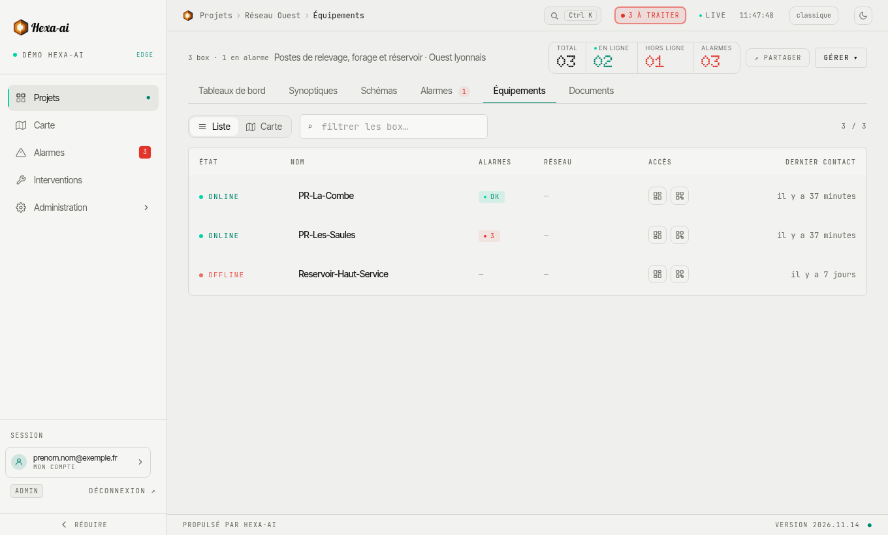
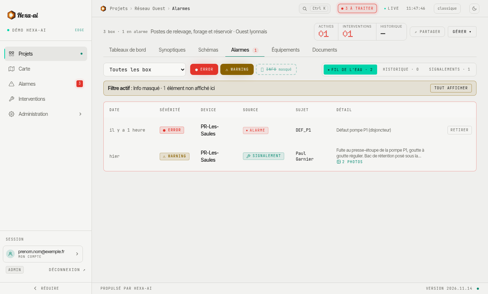
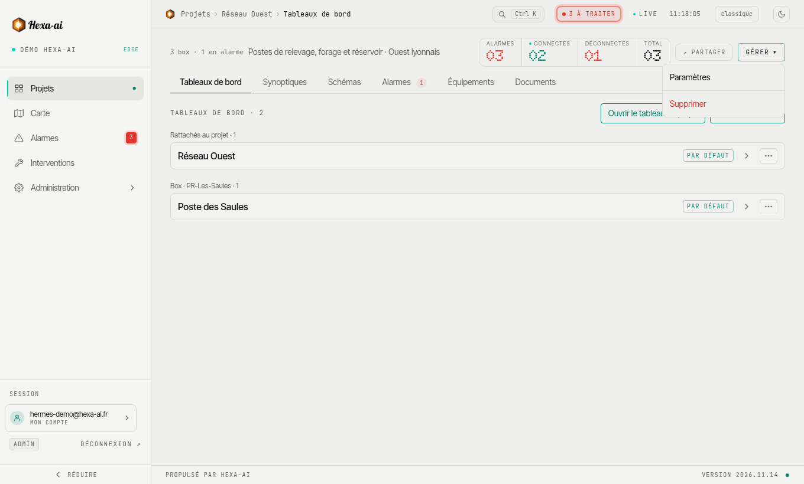
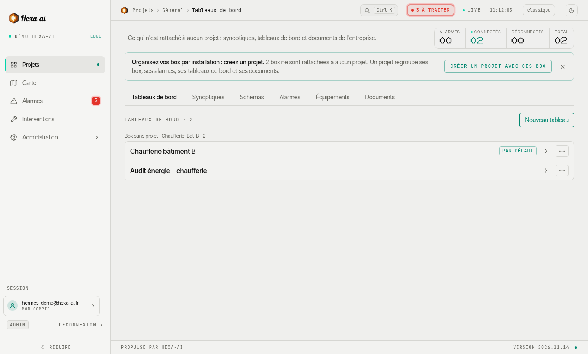

Un **projet** regroupe les box d'un même site ou d'une même machine : un repère sur la carte, des tableaux de bord, des synoptiques et des documents communs. C'est la porte d'entrée du portail.

## La liste des projets

La page **Projets** (premier élément du menu) affiche une carte par projet : son nom, sa description, les compteurs **Équip.**, **En ligne**, **Hors ligne** et **Alarmes**, et la liste de ses box. Le champ de recherche filtre par nom ou par box ; les boutons **Ouverts**, **Fermés** et **Tous** filtrent par statut.

La carte **Général** est particulière : elle réunit tout ce qui n'est rattaché à aucun projet (voir [l'espace Général](#lespace-général)).

## Créer un projet

Le bouton **+ Nouveau projet** est réservé aux administrateurs et aux gestionnaires (voir [Rôles et périmètres](/portal/administration/roles/)).

1. **+ Nouveau projet**.
2. Saisissez le **nom du projet** (site, machine, installation…) et, si vous voulez, une description.
3. Cochez les **box à rattacher** : seules celles qui n'ont pas encore de projet sont proposées.
4. **Créer le projet**.

Une box appartient à un seul projet, ou à aucun. Vous pouvez ensuite en ajouter ou en retirer dans les paramètres du projet.

## La page d'un projet

Cliquer sur une carte ouvre la page du projet. En haut : sa description, les compteurs et deux boutons, **Partager** (voir [Partager avec une personne extérieure](/portal/administration/external-sharing/)) et **Gérer**. Dessous, les onglets :

| Onglet | Ce que vous y trouvez |
|---|---|
| **Tableaux de bord** | Les tableaux du projet et de ses box ; **Ouvrir le tableau du projet** et **Nouveau tableau**. Voir [Tableaux de bord](/portal/dashboards/dashboards/). |
| **Synoptiques** | Les schémas animés (IHM) du projet, rangés en dossiers. Voir [Synoptiques](/portal/synoptics/synoptics/). |
| **Schémas** | Les schémas statiques (électriques, par exemple), eux aussi rangés en dossiers. |
| **Alarmes** | Les alarmes du projet : actives, historique, signalements (voir [Alarmes](/portal/alarms/alarms/)). Un pastille indique le nombre d'alarmes actives. |
| **Équipements** | Les box du projet, en liste ou sur la carte : état, alarmes, réseau, dernier contact. |
| **Documents** | L'explorateur de documents du projet. Voir [Documents](/portal/projects/documents/). |

## Gérer un projet

Le bouton **Gérer** ouvre un menu : **Paramètres** et **Supprimer**.

Les **paramètres** permettent de changer le nom, la description et l'adresse, de rattacher ou retirer des box, de régler l'apparence (cadrage), d'ajouter un logo de projet (il apparaît sur la page de garde des dossiers imprimés) et de **fermer** le projet : un projet fermé reste consultable, en lecture seule. Seuls les administrateurs de l'entreprise (et Hexa-AI) modifient ces paramètres.

**Supprimer le projet** supprime ses tableaux de bord et ses documents ; les box et les synoptiques redeviennent « sans projet ».

## L'espace Général

L'espace **Général** est un projet « virtuel » : il contient ce qui n'est rattaché à aucun projet (synoptiques, tableaux de bord et documents de l'entreprise). Il a les mêmes onglets que les autres projets. Quand des box n'ont pas encore de projet, un bandeau propose **Créer un projet avec ces box**.

## Projets réalisés avec Hexa-AI

Certains projets sont gérés avec Hexa-AI : votre interlocuteur vous présente alors le fonctionnement.
