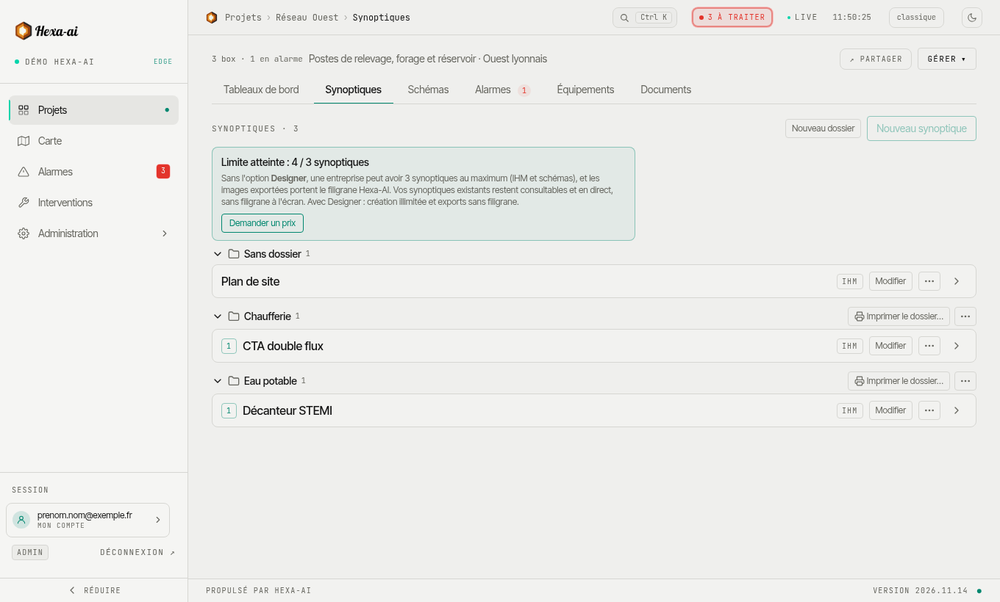

:::caution[Fonction en version bêta]
Cette fonction est en version bêta : son fonctionnement peut évoluer.
:::

Le **Designer** est l'option qui vous permet de dessiner **vos propres** synoptiques et schémas dans le portail. Hexa-AI peut aussi les préparer pour vous.

## Avec ou sans l'option

| | Sans l'option Designer | Avec l'option Designer |
|---|---|---|
| Consulter les synoptiques, en direct | oui | oui |
| Modifier les synoptiques existants | oui (administrateurs et gestionnaires) | oui |
| **Créer** des synoptiques et des schémas | jusqu'à une limite (3 par défaut) | **illimité** |
| Fichiers exportés (images, PDF, export IHM) | portent le filigrane « my.hexa-ai.fr » | **sans filigrane** |

La limite est comptée sur l'ensemble de l'entreprise (synoptiques IHM et schémas confondus). Hexa-AI peut la modifier pour votre entreprise. Le filigrane n'est jamais ajouté **à l'écran** : seulement dans les fichiers produits.

## Où voir l'état de l'option

- Dans la page **Mes abonnements** : une carte **Option Designer** indique la limite et l'échéance (voir [Mes abonnements](/portal/administration/subscriptions/)).
- Dans les onglets **Synoptiques** et **Schémas**, un encart apparaît quand la limite est atteinte.
- Avant un export, un avis rappelle que le fichier portera le filigrane.

## Demander l'option

Le bouton **Demander un prix** (dans l'encart, la page Mes abonnements ou l'avis d'export) envoie votre demande à Hexa-AI, avec un commentaire facultatif (nombre de synoptiques, besoin, délai). Le bouton est réservé aux utilisateurs de l'entreprise.

À l'approche de l'échéance, un rappel vous est envoyé. Pour renouveler, contactez Hexa-AI.
