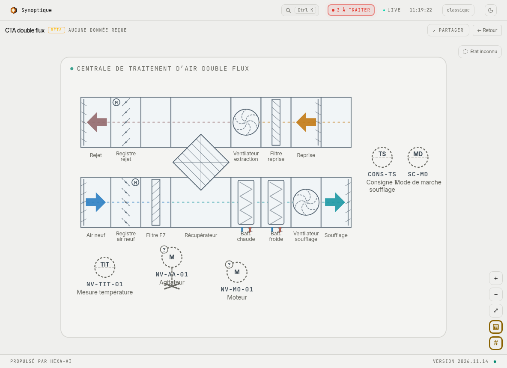
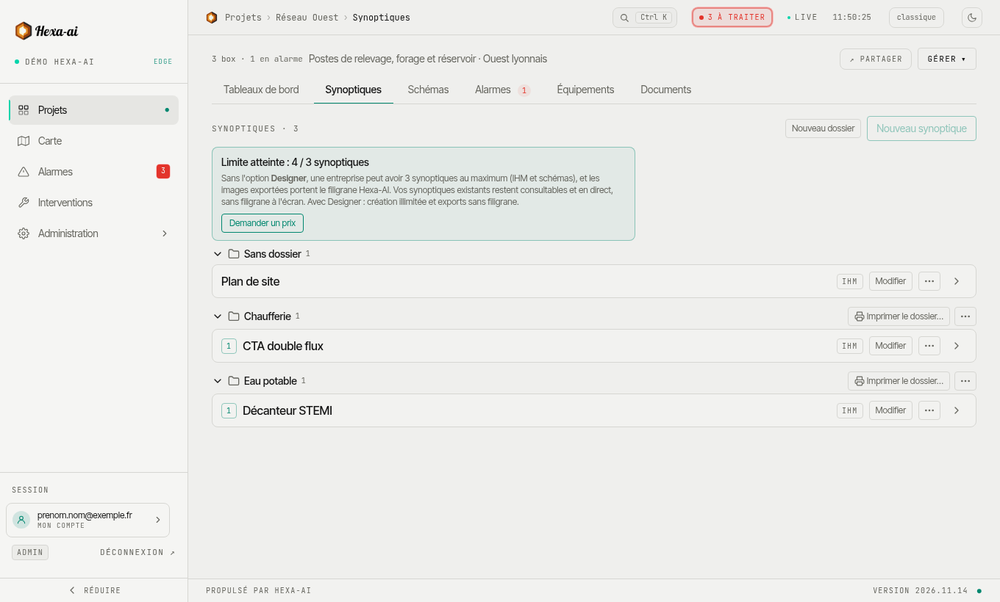
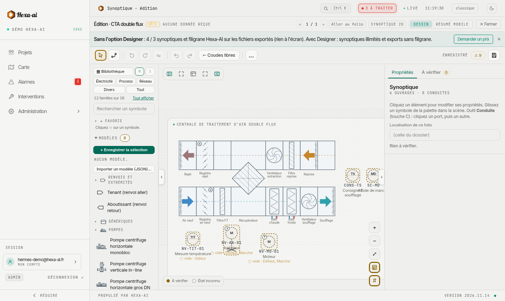

:::caution[Fonction en version bêta]
Cette fonction est en version bêta : son fonctionnement peut évoluer.
:::

Un **synoptique** est le schéma animé de votre installation : cuves, pompes, vannes, tuyaux, mesures. Chaque élément est relié aux variables des box, donc le schéma vit en direct : une pompe change de couleur quand elle démarre, une valeur s'affiche à côté du capteur.

## Consulter

Tous les membres de l'entreprise peuvent consulter les synoptiques :

- dans l'onglet **Synoptiques** (ou **Schémas**) d'un projet : cliquez sur un synoptique pour l'ouvrir en plein cadre ;
- dans un tableau de bord, grâce au bloc **Synoptique (bêta)** ;
- depuis le [Spotlight](/portal/getting-started/navigation/#recherche-rapide--spotlight).

En plein cadre, les boutons **+** et **−** zooment, **⤢** ajuste la vue, **← Retour** revient à la page d'origine. Le bouton **↗ Partager** permet de [donner accès](/portal/administration/external-sharing/) à ce synoptique seul.

Selon le synoptique, une bascule **2D / Iso** et un bouton **3D** changent de représentation : le même dessin, vu à plat, en isométrique ou en 3D.

## Les listes : dossiers, folios

Dans un projet, les synoptiques sont rangés par **dossiers**. Un dossier regroupe les **folios** d'un même ensemble (comme les feuilles d'un dossier de plans) : chaque folio a son numéro, visible devant son nom. Les étiquettes **IHM** et **SCHÉMA** distinguent les deux sortes : un **synoptique (IHM)** est animé par les variables des box ; un **schéma** est un dessin statique, par exemple un schéma électrique.

Le bouton **⋯** d'un synoptique propose, selon vos droits : renommer, déplacer vers un autre dossier, rattacher à une autre box, changer le numéro de folio, passer en schéma, supprimer. Un synoptique supprimé reste **30 jours** dans la corbeille de la bibliothèque, puis il est purgé ; **Restaurer** le remet en place, y compris dans les tableaux qui l'utilisaient.

**Imprimer le dossier…** (menu d'un dossier) produit un PDF unique ; voir [Mise en page, impression et export](/portal/synoptics/export/).

## Dessiner : le Designer

Les administrateurs et les gestionnaires peuvent modifier les synoptiques : bouton **Modifier**, ou **Nouveau synoptique** / **Nouveau dossier** / **Importer un JSON** pour en créer. L'éditeur est réservé aux **ordinateurs** (grand écran et souris) ; sur téléphone ou tablette, le synoptique reste consultable.

Dans l'éditeur :

1. la **Bibliothèque** de gauche propose les symboles, classés en **Électricité**, **Process**, **Réseau** et **Divers** (pompes, vannes, capteurs, renvois…). Cliquez sur un symbole pour le poser, ou marquez-le ★ pour le retrouver dans vos **Favoris** ;
- Les **Modèles** de la bibliothèque (**+ Enregistrer la sélection**, **Importer un modèle (JSON)…**) réutilisent un assemblage d'éléments ;
2. l'outil **Relier deux ports** trace les conduites et les fils ; **Coudes libres** et **Figer les coudes** règlent le comportement des tracés quand vous déplacez un équipement ;
3. le panneau **Propriétés** (à droite) relie le symbole aux **variables** des box : c'est ce qui l'anime ;
4. la barre d'outils propose aussi rotation, miroir, alignement, grille, annuler/rétablir ; le bouton **…** donne accès à la mise en page et à l'export ;
5. **Enregistrer** conserve une nouvelle version.

Le Spotlight de l'éditeur (**Ctrl K** dans l'éditeur) cherche un symbole, un élément ou une variable dans le synoptique.

## Créer autant de synoptiques que vous voulez

Le nombre de synoptiques que vous pouvez **créer** dépend de l'option **Designer** de votre abonnement : voir [L'option Designer](/portal/synoptics/designer/). Sans elle, vous consultez et modifiez ceux qui existent déjà.
